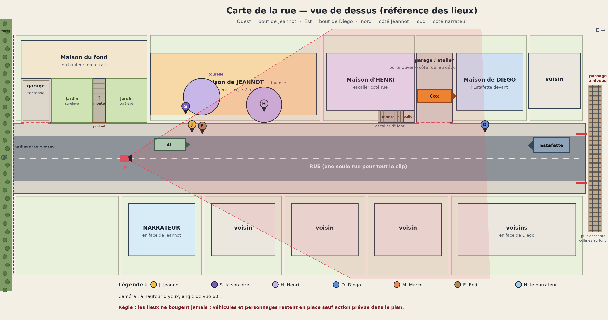
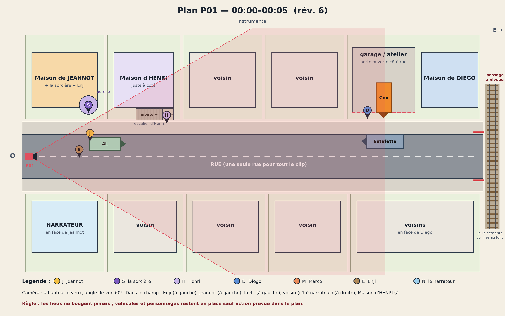
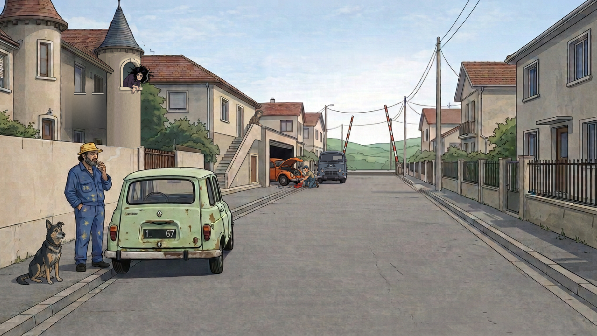
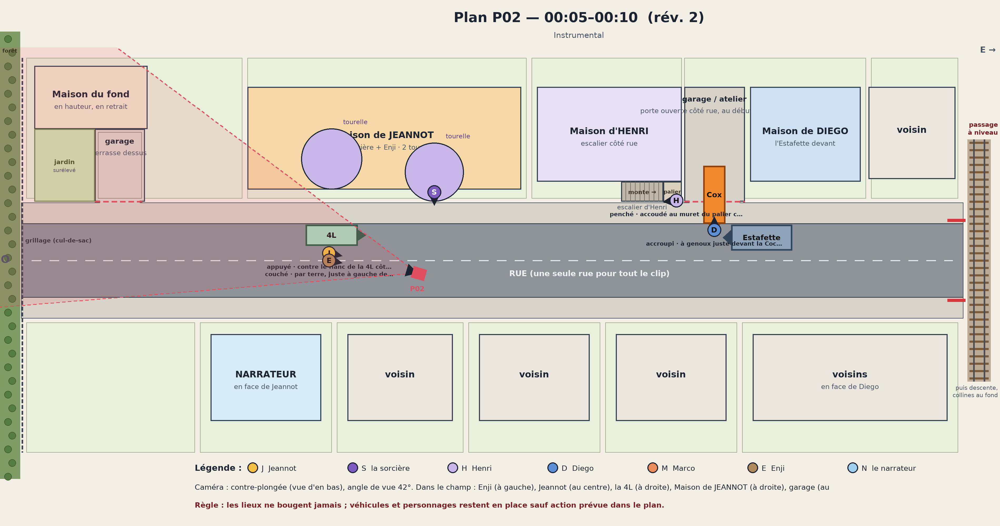
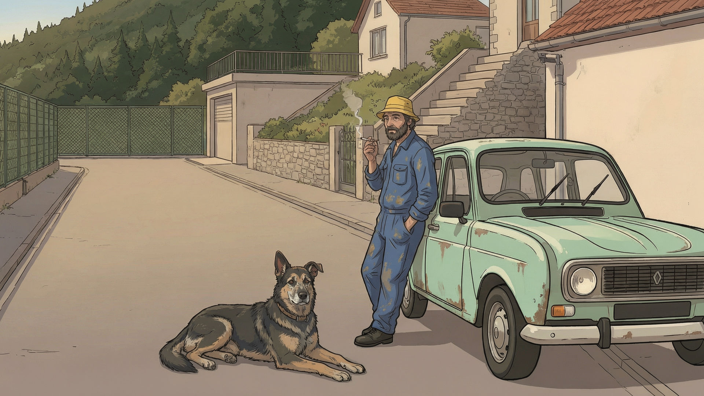
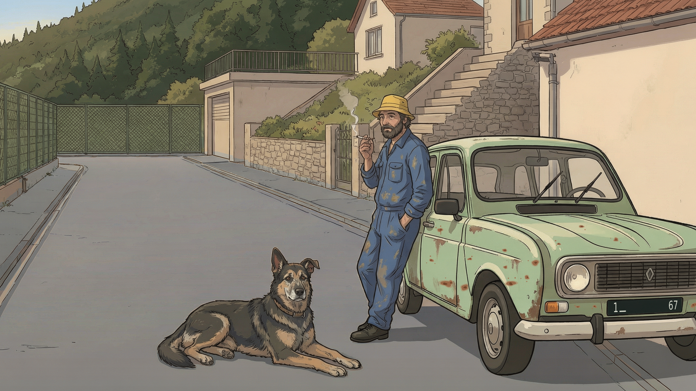
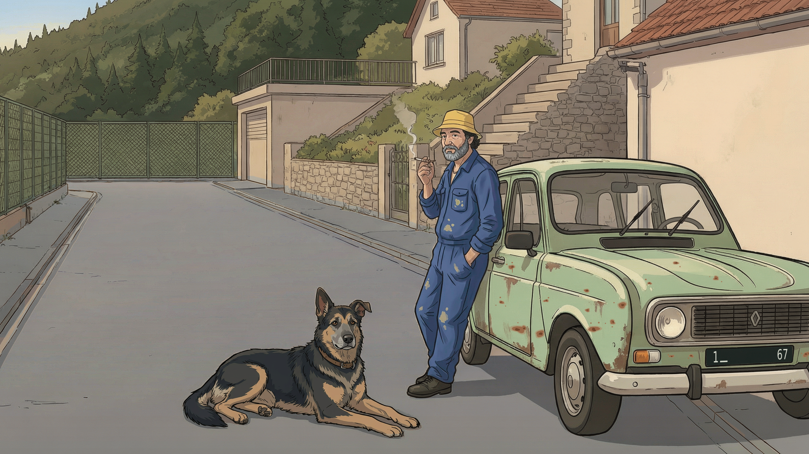
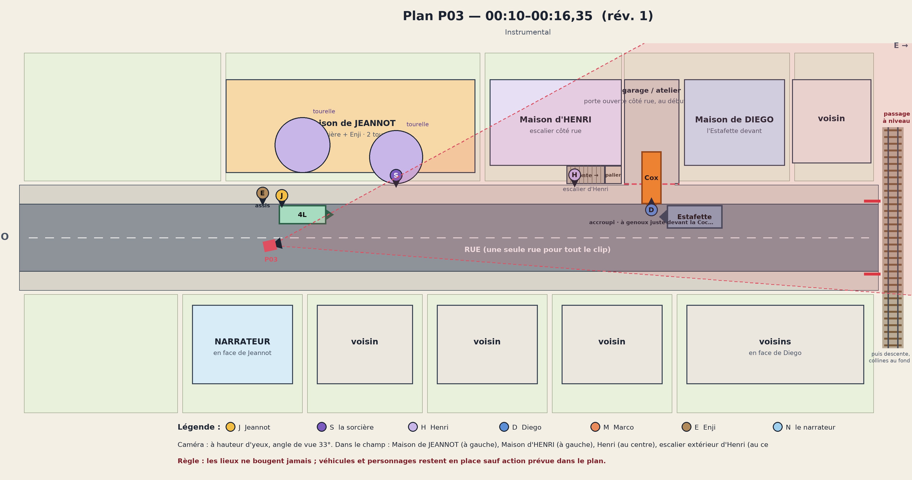

# Storyboard — options à valider

Tri plan par plan. **Toutes les options sont conservées ici** (anciennes versions récupérées dans l'historique Git + nouvelles propositions), pour ne rien perdre si un fil plante.

- Fichier source : [`assets/storyboards/a-valider/options.json`](../assets/storyboards/a-valider/options.json)
- Page de comparaison avec avis : lancer `python3 tools/serve_storyboard.py` puis ouvrir `/storyboard/a-valider.html`
- Régénérer ce fichier : `python3 tools/build_a_valider.py`

## Avancement

| Plan | Temps | Statut | Options | Choix |
|---|---:|---|---:|---|
| [CARTE](#carte) | référence | ✅ Validé | 10 | v10 |
| [P01](#p01) | 00:00–00:05 | ✅ Validé | 28 | v33 |
| [P02](#p02) | 00:05–00:10 | ⏳ À valider | 6 | — |
| [P03](#p03) | 00:10–00:16,35 | ⏳ À valider | 2 | — |
| [P04](#p04) | 00:16,35–00:18,88 | ⏳ À valider | 1 | — |
| [P05](#p05) | 00:18,88–00:21,42 | ⏳ À valider | 3 | — |
| [P06](#p06) | 00:21,42–00:23,95 | ⏳ À valider | 1 | — |
| [P07](#p07) | 00:23,95–00:26,48 | ⏳ À valider | 1 | — |
| [P08](#p08) | 00:26,48–00:29,02 | ⏳ À valider | 1 | — |
| [P09](#p09) | 00:29,02–00:31,47 | ⏳ À valider | 1 | — |
| [P10](#p10) | 00:31,47–00:33,91 | ⏳ À valider | 1 | — |
| [P11](#p11) | 00:33,91–00:36,36 | ⏳ À valider | 2 | — |
| [P12](#p12) | 00:36,36–00:38,80 | ⏳ À valider | 3 | — |
| [P13](#p13) | 00:38,80–00:41,25 | ⏳ À valider | 1 | — |
| [P14](#p14) | 00:41,25–00:43,69 | ⏳ À valider | 1 | — |
| [P15](#p15) | 00:43,69–00:50,35 | ⏳ À valider | 1 | — |
| [P16](#p16) | 00:50,35–00:53,70 | ⏳ À valider | 1 | — |
| [P17](#p17) | 00:53,70–00:57,24 | ⏳ À valider | 1 | — |
| [P18](#p18) | 00:57,24–01:00,78 | ⏳ À valider | 1 | — |
| [P19](#p19) | 01:00,78–01:03,99 | ⏳ À valider | 1 | — |
| [P20](#p20) | 01:03,99–01:07,53 | ⏳ À valider | 1 | — |
| [P21](#p21) | 01:07,53–01:11,71 | ⏳ À valider | 1 | — |
| [P22](#p22) | 01:11,71–01:14,92 | ⏳ À valider | 1 | — |
| [P23](#p23) | 01:14,92–01:18,13 | ⏳ À valider | 1 | — |
| [P24](#p24) | 01:18,13–01:22,00 | ⏳ À valider | 1 | — |
| [P25](#p25) | 01:22,00–01:25,70 | ⏳ À valider | 1 | — |
| [P26](#p26) | 01:25,70–01:29,45 | ⏳ À valider | 1 | — |
| [P27](#p27) | 01:29,45–01:33,20 | ⏳ À valider | 1 | — |
| [P28](#p28) | 01:33,20–01:37,00 | ⏳ À valider | 1 | — |
| [P29](#p29) | 01:37,00–01:44,36 | ⏳ À valider | 1 | — |

## CARTE

**référence** · Carte des lieux (vue de dessus) · ✅ Validé · choix : **v10**

> Référence de cohérence pour tous les plans. Une seule rue ouest→est. Côté nord (côté Jeannot), d'ouest en est : maison de Jeannot avec la tourelle de la sorcière (elle vit chez Jeannot, avec Enji), maison d'Henri juste à côté avec son escalier extérieur, voisins, puis maison de Diego et son garage/atelier avec la Coccinelle orange sur parpaings. Côté sud : le narrateur en face de Jeannot, puis des voisins. L'unique 4L, très rouillée, est garée contre le trottoir nord devant chez Jeannot, nez vers l'est (vers Diego) ; l'Estafette est garée devant chez Diego. Chaque plan validé y reçoit sa caméra et son champ de vision.

**CARTE · v10** — ✅ retenue — tools/draw_street_map.py base v10 (lieux rév. 12)  
D'après ton message sur les nouveaux lieux : la maison du fond est élargie jusqu'à la limite de chez Jeannot ; le garage avec la terrasse dessus passe à l'ouest et le jardin surélevé à l'est ; un portail sur le trottoir ouvre sur un escalier qui monte à la maison et coupe le jardin en deux. Tout le reste est identique à la v9 (vérifié au pixel près).

🗄️ 9 option(s) écartée(s) : v1, v2, v3, v4, v5, v6, v7, v8, v9

- **v1** — nouveau fil, dessinée par script (tools/draw_street_map.py), version SVG à côté : carte-rue-v1.svg — ../assets/storyboards/a-valider/carte/carte-rue-v1.png
  - 💬 *2026-10-11 11:13* — inverser la position de la maison et du garage de diego .
et repositionner l'estafette devant la maison. Il faut qu'on puisse avoir une vue dégagé du garage ouvert avec la coccinnelle dedans.
- **v2** — nouveau fil, d'après ton avis sur v1 (SVG : carte-rue-v2.svg) — ../assets/storyboards/a-valider/carte/carte-rue-v2.png
  - 💬 *2026-10-11 11:25* — C'est bon ça servira de ref à la carte  interactive pour chaque plan que je t'ai demandé
  - 💬 *2026-10-13 09:58* — il faut que la tourelle soit à la droite de la maison  c'est le coté opposé
- **v3** — tools/draw_street_map.py base v3 (lieux rév. 5) — ../assets/storyboards/a-valider/carte/carte-rue-v3.png
- **v4** — tools/draw_street_map.py base v4 (lieux rév. 6) — ../assets/storyboards/a-valider/carte/carte-rue-v4.png
  - 💬 *2026-10-13 11:54* — le garage doit être aligné au fond des 2 autres maisons et l ouverture de celui-ci doit être alignée au début du trottoir ou à l escalier d Henri (c est le même résultat). (avis transmis dans le chat : l envoi avait échoué)
- **v5** — tools/draw_street_map.py base v5 (lieux rév. 7) — ../assets/storyboards/a-valider/carte/carte-rue-v5.png
- **v6** — tools/draw_street_map.py base v6 (lieux rév. 8) — ../assets/storyboards/a-valider/carte/carte-rue-v6.png
- **v7** — tools/draw_street_map.py base v7 (lieux rév. 9) — ../assets/storyboards/a-valider/carte/carte-rue-v7.png
- **v8** — tools/draw_street_map.py base v8 (lieux rév. 10) — ../assets/storyboards/a-valider/carte/carte-rue-v8.png
- **v9** — tools/draw_street_map.py base v9 (lieux rév. 11) — ../assets/storyboards/a-valider/carte/carte-rue-v9.png

## P01

**00:00–00:05** · Instrumental · ✅ Validé · choix : **v33**

> Plan général maître de la rue, avec avant-plan dégagé. Une 4L vert menthe unique, à échelle réaliste, reste sur l'asphalte au bord du trottoir gauche devant chez Jeannot ; l'Estafette bleu-gris est plus loin sur le même côté.

🗺️ Carte du plan (rév. 15, 2026-10-14 15:25) :

**P01 · v33** — ✅ retenue — tools/p01_v33.py — la v32 ; les collages de la v16 (capot ouvert, outils au sol) et de la v17 (fond autour de Diego) refaits à l'identique mais sans l'adoucissement de l'ancien contrôle, sans IA · contrôle : tools/controle_retouche.py → p01-v33-controle.jpg · 🟢 conforme à la carte actuelle (rév. 15)  
La v32 sans les restes de flou que tu as pointés autour de Diego (zone 1-2-3-4). Ils venaient bien de l'ancien contrôle : à l'époque, son critère « grain » faisait adoucir les collages. Le capot ouvert, le compartiment moteur et les outils au sol (v16), puis tout le fond autour de Diego (clôture, piliers, haie, v17) avaient été collés volontairement flous. La v20 avait rendu nets Diego, sa caisse et l'Estafette, mais pas ces deux collages-là. Je les ai refaits à l'identique, avec les mêmes images d'origine, mais sans flou : rien n'est redessiné, seul le flou disparaît. Tout le reste est exactement la v32, Henri d'ed5 compris. Contrôle CONFORME (couleurs 97 %, netteté ×1,05, raccord 0,0).

- 💬 *2026-10-14 15:17* — C'est ok quand le storyboard sera terminé  il faudra upscale l'image pour faire du 1080p en augmentant la qualité et les détails de l'image sans la changer . LA après avoir mis à jour la position d'henri sur la carte  on peut passer à la P02 enfin  , on se base évidant avec la P01 pour la réf de l'image  en tenant comptes des indications de la p02 pour la position des perso voiture et caméra

🗄️ 27 option(s) écartée(s) : v1, v2, v3, v4, v5, v6, v7, v8, v9, v10, v11, v12, v13, v16, v17, v18, v19, v20, v24, v25, v26, v27, v28, v29, v30, v31, v32

- **v1** — ancien fil, commit f1eccd4 (03h40) — ../assets/storyboards/a-valider/p01/p01-v1-ancien-fil-03h40.png
- **v2** — ancien fil, commit 068faf0 (03h48) — ../assets/storyboards/a-valider/p01/p01-v2-ancien-fil-03h48.png
- **v3** — ancien fil, commit dda932f (06h01) — ../assets/storyboards/a-valider/p01/p01-v3-ancien-fil-06h01.png
- **v4** — nouveau fil, généré le 11/10 à partir de v3 + photo de référence + style frame Jeannot — ../assets/storyboards/a-valider/p01/p01-v4-nouveau.png
  - 💬 *2026-10-11 10:58* — Je préfère la 4L vue de derrière (comme sur la photo de référence). Elle était aussi en moins bon état que sur cette version : plus rouillée, plus abîmée.
- **v5** — nouveau fil, généré le 11/10 d'après la carte v1 + photo de référence + style frame + v4 — ../assets/storyboards/a-valider/p01/p01-v5-nouveau.png
- **v6** — nouveau fil, retouche de v5 pour coller à la carte v1 — ../assets/storyboards/a-valider/p01/p01-v6-nouveau.png
  - 💬 *2026-10-11 11:14* — il faudra  prendre en compte  mon avis  de l'image de la carte
  - 💬 *2026-10-11 11:15* — il faudra  prendre en compte  mon avis  de l'image de la carte  
Pour le garage de diego
- **v7** — nouveau fil, retouche de v6 avec la carte v2 — ../assets/storyboards/a-valider/p01/p01-v7-nouveau.png
  - 💬 *2026-10-11 11:26* — Pour  le garage je préfère  devant l'estafette  qu'on puisse juste distingué une ouverture  ça sera juste pour les plan  ou il faudra voir le garage  mais que ça soit cohérent avec la rue
- **v8** — nouveau fil, retouche de v6 d'après ton avis sur v7 (garage = simple ouverture, rue cohérente) — ../assets/storyboards/a-valider/p01/p01-v8-nouveau.png
  - 💬 *2026-10-11 11:50* — la rue se termine après l'estafette de diego  par un passage à niveau de train  elle descend ensuite donc on plus des collines au fond
- **v9** — nouveau fil, générée d'après ta carte P01 rév. 1 + v8 (style) + photo de référence — ../assets/storyboards/a-valider/p01/p01-v9-carte-rev1.png
  - 💬 *2026-10-11 12:08* — (remarque donnée dans le chat) J’ai choisi l’image du passage à niveau. Il faut qu’il soit ouvert, avec les rails de chemin de fer entre les 2 barrières, sinon c’est bizarre juste la route. Après, la route descend à 45°, on ne la voit plus.
- **v10** — nouveau fil, retouche de v9 d'après ta carte P01 rév. 2 (+ fiche d'Enji) — ../assets/storyboards/a-valider/p01/p01-v10-carte-rev2.png
- **v11** — nouveau fil, retouche de v10 d'après ta carte P01 rév. 4 (lieux rév. 3) — ../assets/storyboards/a-valider/p01/p01-v11-carte-rev4.png
  - 💬 *2026-10-11 12:24* — depuis  l'ajout du passage à niveau le style de dessin à changer ce n'est plus pareil  et jeannot et les perso sont different aussi on dirait que c'est pas le même ia qui a généré , il faut revenir au style d'avant et vérifier les cohérences  ça srait bien d'enlever les images écarter   du storyboard à valider
- **v12** — nouveau fil, retouche de v8 (retour au style d'avant le passage à niveau) d'après ta carte P01 rév. 4 — ../assets/storyboards/a-valider/p01/p01-v12-style-v8-rev4.png
  - 💬 *2026-10-11 12:40* — le fond de la rue n'est plus bon il faut reprendre celui de la V11 vérifier que henri ressemble bien à henri  ce qui n'est pas du tout le cas de même pour Diego au fond
- **v13** — nouveau fil, montage : v12 (style v8) + fond de rue de v11, Henri et Diego refaits d'après leurs fiches, carte P01 rév. 5 — ../assets/storyboards/a-valider/p01/p01-v13-montage-rev5.png
  - 💬 *2026-10-11 12:50* — l'estafette ne ressemble plus trop  celle du début et il y a un souci de corrélation des postions sur la carte et celle généré la coccinelle à le bout  du nez à la limite de la sortie du garage sur le plan et là elle sort sur le trottoire
  - 💬 *2026-10-13 09:48* — il reste à corriger l'estafette qui ne ressemble plus à celle du début qui était bien  prend exemple sur celle qu'il y a en P02 V2
  - 💬 *2026-10-13 09:51* — il reste à corriger l'estafette qui ne ressemble plus à celle du début qui était bien  prend exemple sur celle qu'il y a en P02 V2 ou même mieux P03 il faudrait aussi que le capot de la coccinelle soit ouvert avec des outils au sol
- **v16** — tools/p01_v16.py (retouches locales sur v13) · contrôle : tools/controle_retouche.py → p01-v16-controle.jpg — ../assets/storyboards/a-valider/p01/p01-v16-retouche-v13.png
  - 💬 *2026-10-13 11:54* — la sorcière est trop petite pareil pour l ouverture de sa tourelle et elle doit être en train de fumer aussi. Diego doit être à genou devant sa caisse à outils. (avis transmis dans le chat : l envoi avait échoué)
- **v17** — tools/p01_v17.py (retouches locales sur v16) · contrôle : tools/controle_retouche.py → p01-v17-controle.jpg — ../assets/storyboards/a-valider/p01/p01-v17-retouche-v16.png
  - 💬 *2026-10-13 12:45* — refaire l'estafette pour quelle ressemble plus à une estafette  et ne pas oublier l'ajout du logo renault devant. Il faut égaleme encore agrandir  la tourelle et la soriciere légerement  et quelle sorte un poll plus la tête
- **v18** — tools/p01_v18.py (retouches locales sur v17) · contrôle : tools/controle_retouche.py → p01-v18-controle.jpg — ../assets/storyboards/a-valider/p01/p01-v18-retouche-v17.png
  - 💬 *2026-10-13 13:12* — un problème avec la sorcière  elle est flou et pas défini et la couleur de la façade de la tourelle fait plus proppre que le reste de la maison
- **v19** — tools/p01_v19.py (retouches locales sur v18) · contrôle : tools/controle_retouche.py → p01-v19-controle.jpg — ../assets/storyboards/a-valider/p01/p01-v19-retouche-v18.png
  - 💬 *2026-10-13 14:50* — Henri  aura une pose  pencher appuiyé sur le rebord du mu muret sur le palier en haut de son escalier en train de fumer auss le viage tourner vers la 4l.
Il y a comme un portail avec 2 pilier qui chevauche l'escalier d'Henri en dessous .  il n'a aucun interet, rakoute plutot une porte  directement sur la maison  c'est plus logique .
- **v20** — tools/p01_v20.py (même contenu que v19, ajouts reconstruits sans flou) · contrôle : tools/controle_retouche.py → p01-v20-controle.jpg — ../assets/storyboards/a-valider/p01/p01-v20-nette.png
  - 💬 *2026-10-14 10:43* — retire moi le portail avec la cloture qu'il y a sous l'escalier d'henri
- **v24** — tools/p01_v24.py A — repart de la v20, édition locale work/crop-v24-A-ed.png · contrôle : tools/controle_retouche.py → p01-v24-controle.jpg — ../assets/storyboards/a-valider/p01/p01-v24-sans-portail.png
- **v25** — tools/p01_v24.py B — v24 + porte prise dans work/crop-v24-B-ed.png · contrôle : tools/controle_retouche.py → p01-v25-controle.jpg — ../assets/storyboards/a-valider/p01/p01-v25-porte.png
- **v26** — tools/p01_v26.py — part de la v24 · contrôle : tools/controle_retouche.py → p01-v26-controle.jpg — ../assets/storyboards/a-valider/p01/p01-v26-rampe.png
- **v27** — tools/p01_v27.py — v26 + porte dessinée sur la v26 (work/crop-v27-ed.png) · contrôle : tools/controle_retouche.py → p01-v27-controle.jpg — ../assets/storyboards/a-valider/p01/p01-v27-porte.png
- **v28** — tools/p01_v28.py — v27 retouchée au pixel (aucune IA) · contrôle : tools/controle_retouche.py → p01-v28-controle.jpg — ../assets/storyboards/a-valider/p01/p01-v28-trait.png
- **v29** — tools/p01_v29.py — v28 ; Henri effacé des marches au pixel (sans IA), puis Henri dessiné par IA sur le recadrage du palier (work/crop-v29-ed6.png, modèle de pose work/henri-pose-v29.png) et recollé au ras de sa silhouette · contrôle : tools/controle_retouche.py → p01-v29-controle.jpg — ../assets/storyboards/a-valider/p01/p01-v29-henri-palier.png
- **v30** — tools/p01_v30.py — v28 ; Henri effacé des marches comme pour la v29 (au pixel, sans IA), puis Henri redessiné par IA sur le recadrage du palier présenté en miroir (work/crop-v30-ed3-miroir.png, remis à l'endroit : work/crop-v30-ed3.png) et recollé au ras de sa silhouette et de sa fumée · contrôle : tools/controle_retouche.py → p01-v30-controle.jpg — ../assets/storyboards/a-valider/p01/p01-v30-henri-regard.png
- **v31** — tools/p01_v31.py — la v29 ; seule la tête d'Henri est refaite par IA sur le recadrage du palier en miroir, avec la tête de P08 v1 comme référence (proposition 2 que tu as choisie : work/crop-v31-ed1-miroir.png), puis Henri est recollé au ras de sa silhouette · contrôle : tools/controle_retouche.py → p01-v31-controle.jpg — ../assets/storyboards/a-valider/p01/p01-v31-tete-p08.png
- **v32** — tools/p01_v32.py — la v29 ; l'Henri de l'essai ed5 repris de ta capture d'écran (work/ed5-capture.png, déposée par la page de dépôt), recalée automatiquement sur le recadrage du palier et recollée au ras de sa silhouette · contrôle : tools/controle_retouche.py → p01-v32-controle.jpg — ../assets/storyboards/a-valider/p01/p01-v32-ed5.png
  - 💬 *2026-10-14 14:39* — 📍 pointages sur l'image :
1. (866, 445) — verifie  la zone intérieur des points 1 2 3 et 4 il y a des reste de flou  de l'ancien controle
2. (860, 622)
3. (1119, 625)
4. (1112, 442)

## P02

**00:05–00:10** · Instrumental · ⏳ À valider

> Glissement vers la maison de Jeannot et sa 4L vert menthe, rouillée mais intacte. Jeannot respire, décale son poids et tient sa cigarette ; Enji traverse le cadre pour son gag.

🗺️ Carte du plan (rév. 2, 2026-10-14 16:39) :

**P02 · v1** — 🔁 à retoucher — ancien fil, commit 2db27a6 (03h55) · ⚪ faite sans carte du plan  
Add P02 storyboard keyframe and progress tracker

- 💬 *2026-10-14 15:38* — je verrais plutot se genre de  position et de pose pour jeannot. Enji je la verrai plutôt couché à la gauche des pieds de jeannot. La 4l ne bouge de sa position P01 par contre les lieux seront la P01 je vais placer tout ça comme je peux sur la carte interactive . Il faut que la caméra soit placé  de façon à avoir le même angle et la même vue que sur ce plan  par rapport à la 4L seulement.  Tu corrigera la carte interactive si besoin

**P02 · v2** — ⏳ à valider — ancien fil, commit e2a3352 (06h33) · ⚪ faite sans carte du plan  
Reframe P02 with fixed 4L continuity — version en place dans le storyboard

**P02 · v3** — ⏳ à valider — IA, nouveau fil : 2 propositions, la n° 2 choisie par toi dans la conversation (l'autre n'a pas été enregistrée). Références : P02 v1 retournée (composition), P01 v33 (style, lieux, personnages), fiche d'Enji. Recadrée en 16:9 puis mise en 1920×1080 ; image brute : p02/work/p02-essai-1.png · 🟢 conforme à la carte actuelle (rév. 2)  
D'après ton avis sur la v1 et la carte P02 rév. 2 : la composition de la v1 vue en miroir (la 4L reste à sa place de P01, donc à droite), Jeannot adossé au flanc de la 4L qui fume, une main dans la poche, Enji couchée à gauche de ses pieds. Au fond : le cul-de-sac avec le grillage sur toute la largeur, la colline boisée raide, le garage avec la terrasse dessus, le portail et l'escalier qui monte à la maison du fond, et le mur de chez Jeannot à droite. Deux défauts repérés : le volant est du côté proche (conduite à droite, alors qu'une 4L française l'a de l'autre côté), et les couleurs sont plus beiges que dans P01 (route beige au lieu de grise, peu de ciel).

**P02 · v4** — ⏳ à valider — tools/p02_v4.py — la v3 avec les 2 premiers correctifs, sans IA · contrôle : tools/controle_retouche.py → p02-v4-controle.jpg (CONFORME : hors zones 0,00 ; volant netteté ×0,88 ; sol ×0,94 ; ciel ×1,00) · corrigée avant présentation : la tache de peinture claire du genou gauche de Jeannot avait été prise pour une bordure de trottoir et grisée (421 px) ; elle est rendue à l'identique de la v3 · 🟢 conforme à la carte actuelle (rév. 2)  
Correctifs 1 et 2 de la liste (14/10) : 1) le volant passe du côté conducteur (une 4L française l'a à gauche, donc ici derrière la moitié éloignée du pare-brise) ; 2) la chaussée, les trottoirs et les bordures passent du beige au gris de P01 (chaque surface prend la teinte de la même surface dans P01, ombres et texture gardées) et le coin de ciel passe du gris-vert à un bleu pâle — le bleu franc de P01 n'existe pas dans l'image et le contrôle le refuse : il viendra avec le point « plus de ciel ». Tout le reste est identique à la v3, au pixel près.

**P02 · v5** — ⏳ à valider — tools/p02_v5.py — la v4 avec les correctifs 3 et 4, sans IA · contrôle : tools/controle_retouche.py → p02-v5-controle.jpg (CONFORME : hors zones 0,00 ; carrosserie : couleurs 98 %, netteté ×1,40 ; arrière de la 4L derrière Jeannot : couleurs 96 %, netteté ×1,75) · 🟢 conforme à la carte actuelle (rév. 2)  
Correctifs 3 et 4 de la liste : 3) la plaque avant devient noire avec « 1_ 67 » en caractères fins gris clair, comme la plaque arrière de la 4L dans P01 ; 4) la peinture prend la teinte de la 4L de P01 (vert amande plus jaune et plus sourd que le menthe de la v4, ombres et reflets gardés), la rouille existante passe au brun plus sombre de P01, et 16 taches de rouille brunes (quelques coulures courtes, quelques points) sont ajoutées sur les portières, l'aile, le capot et la face avant. Tout le reste est identique à la v4 au pixel près (Jeannot, Enji, les lieux, le volant, le sol).

**P02 · v6** — ⏳ à valider — tools/p02_v6.py — la v5 avec les correctifs 5 et 6 : retouches IA de Jeannot et d'Enji sur des recadrages (Jeannot : 2e essai ; le 1er, en bleu roi à grosses étoiles jaunes et cheveux gris, est écarté — p02/work/v6-ia-jeannot-miroir.png), collage de leur seule silhouette, Jeannot recoloré matière par matière sur celui de P01 · contrôle : tools/controle_retouche.py --palette p01-v33-net.png → p02-v6-controle.jpg (CONFORME : hors zones 0,00 ; Enji couleurs 100 %, netteté ×1,35 ; Jeannot couleurs 100 %, netteté ×0,82) · 🟢 conforme à la carte actuelle (rév. 2)  
Correctifs 5 et 6 de la liste : 5) Jeannot comme dans P01 : barbe poivre et sel, cheveux sombres et bouclés sous le bob, cordon au cou, bob jaune doré, bleu de travail cobalt avec quelques taches de peinture jaune-ocre ; 6) Enji comme dans P01 et sur sa fiche : même pelage noir et feu, museau grisé, oreille pliée, collier brun, dessin plus simple et moins réaliste. Même pose et même place pour les deux. Tout le reste est identique à la v5 au pixel près (la 4L, les lieux, le sol). Le contrôle admet aussi les couleurs de P01 (nouvelle option --palette) : le bleu cobalt et le jaune doré demandés n'existent pas dans la v5.

## P03

**00:10–00:16,35** · Instrumental · ⏳ À valider

> Pan vers la maison voisine et l'escalier d'Henri, puis vers la tourelle de la sorcière et l'autre bout de la rue où se trouve Diego. Finir le mouvement sur Jeannot, prêt pour la première entrée vocale.

🗺️ Carte du plan (rév. 1, 2026-10-13 13:16) :

**P03 · v1** — ⏳ à valider — ancien fil, commit 7bda9a7 (03h56) · ⚪ faite sans carte du plan  
Add P03 street geography storyboard frame

**P03 · v2** — ⏳ à valider — ancien fil, commit ea24889 (06h34) · ⚪ faite sans carte du plan  
Reframe P03 with master street layout — version en place dans le storyboard

## P04

**00:16,35–00:18,88** · « Jeannot est là, et toujours là ! » · ⏳ À valider

> Plan moyen 3/4 de Jeannot près de la 4L. Il lève la cigarette vers la bouche, inspire ; épaules et torse bougent, puis il relâche son souffle. Une seule fumée évolue avec le geste. Léger push-in ; la 4L reste visible.

**P04 · v1** — ⏳ à valider — ancien fil, commit 36af4fe (03h57) · ⚪ faite sans carte du plan  
Add P04 Jeannot performance storyboard frame — version en place dans le storyboard

## P05

**00:18,88–00:21,42** · « La sorcière est partie, Jeannot est encore là » · ⏳ À valider

> La sœur descend de la tourelle et s'éloigne sur le trottoir droit, cigarette à la main, en tenant Enji en laisse. Jeannot reste près de son unique 4L, à l'emplacement fixe devant chez lui.

**P05 · v1** — ⏳ à valider — ancien fil, commit 1798b2b (03h57) · ⚪ faite sans carte du plan  
Add P05 witch departure storyboard frame

**P05 · v2** — ⏳ à valider — ancien fil, commit be42921 (05h28) · ⚪ faite sans carte du plan  
Correct P05 car continuity and leash Enji

**P05 · v3** — ⏳ à valider — ancien fil, commit f1d2b39 (06h24) · ⚪ faite sans carte du plan  
Reframe P05 around fixed 4L and leashed Enji — version en place dans le storyboard

## P06

**00:21,42–00:23,95** · « Alors Henri s'enfuit, Jeannot est toujours là » · ⏳ À valider

> Plan latéral de course. Henri part de la maison voisine et traverse le haut des marches ; bras, épaules, tête et jambes ont des poses distinctes. Garder lunettes, cigarette et sourire lisibles.

**P06 · v1** — ⏳ à valider — ancien fil, commit 1529fa5 (03h58) · ⚪ faite sans carte du plan  
Add P06 Henri running storyboard frame — version en place dans le storyboard

## P07

**00:23,95–00:26,48** · « La sorcière est revenue, c'est la merde dans la rue » · ⏳ À valider

> Whip-pan vers la tourelle ; la sorcière réapparaît, puis petit push-in sur son air fatigué. Réaction comique dans la rue, sans dialogue ni nouveau texte.

**P07 · v1** — ⏳ à valider — ancien fil, commit 45092df (03h59) · ⚪ faite sans carte du plan  
Add P07 witch return storyboard frame — version en place dans le storyboard

## P08

**00:26,48–00:29,02** · « Henri tombe des escaliers, toutes ses dents sont esquintées » · ⏳ À valider

> Tilt vers l'escalier et suivi continu : Henri perd pied, tente de se rattraper, pose main et genou sur une marche, glisse et finit assis en bas. Pas de salto ni rotation complète. Petit flash/poussière sur « dents », puis tenir son sourire aux dents ébréchées, sans gore ; Enji accourt sur le dernier temps.

**P08 · v1** — ⏳ à valider — ancien fil, commit 862007f (04h02) · ⚪ faite sans carte du plan  
Add P08 Henri fall storyboard frame — version en place dans le storyboard

## P09

**00:29,02–00:31,47** · « Jeannot a gagné, Jeannot est toujours là » · ⏳ À valider

> Jeannot se redresse devant sa 4L et prend une pose héroïque ; flash bref et motif graphique récurrent. Aucun dommage à la voiture.

**P09 · v1** — ⏳ à valider — ancien fil, commit c00899b (04h03) · ⚪ faite sans carte du plan  
Add P09 Jeannot victory storyboard frame — version en place dans le storyboard

## P10

**00:31,47–00:33,91** · « Il ne partira pas, il restera là » · ⏳ À valider

> Gros plan de Jeannot, puis recul vers la maison entière. Il reste solidement ancré dans la rue ; aura encore discrète.

**P10 · v1** — ⏳ à valider — ancien fil, commit da041ab (04h11) · ⚪ faite sans carte du plan  
Add P10 Jeannot stays storyboard frame — version en place dans le storyboard

## P11

**00:33,91–00:36,36** · « La 4 ailes dans la rue, le bordel est revenu » · ⏳ À valider

> Plan sur la 4L depuis le même côté ; révéler sa forme carrée et sa rouille sans changer son emplacement ni son orientation. Léger frémissement comique possible, mais elle demeure intacte.

**P11 · v1** — ⏳ à valider — ancien fil, commit d87986c (04h12) · ⚪ faite sans carte du plan  
Add P11 Renault 4L storyboard frame

**P11 · v2** — ⏳ à valider — ancien fil, commit 676c4e3 (04h22) · ⚪ faite sans carte du plan  
Lock Renault 4L position and correct P11 frame — version en place dans le storyboard

## P12

**00:36,36–00:38,80** · « Le rat guette, dans son estafette » · ⏳ À valider

> Plan large depuis l'extrémité de Jeannot : la 4L reste au premier plan à son emplacement fixe ; l'Estafette bleu-gris est plus loin sur le même trottoir gauche. « Le rat », c'est Diego : seule sa tête et un peu d'épaule dépassent de la fenêtre conducteur ; visage conforme au concept approuvé. Aucun doublon de voiture ni personnage supplémentaire.

**P12 · v1** — ⏳ à valider — ancien fil, commit 235f743 (04h13) · ⚪ faite sans carte du plan  
Add P12 Diego in Estafette storyboard frame

**P12 · v2** — ⏳ à valider — ancien fil, commit 486eb5b (06h22) · ⚪ faite sans carte du plan  
Correct P12 Diego's peeking Estafette shot

**P12 · v3** — ⏳ à valider — ancien fil, commit a43d5e7 (06h55) · ⚪ faite sans carte du plan  
Correct P12 van and 4L depth order — version en place dans le storyboard

## P13

**00:38,80–00:41,25** · « La sorcière d'sa tourelle, attend son Roméo » · ⏳ À valider

> Contre-plongée sur la sorcière à sa fenêtre ; son regard suit Diego dans l'Estafette. Cigarette, mascara et fatigue restent lisibles.

**P13 · v1** — ⏳ à valider — ancien fil, commit 9599dff (04h14) · ⚪ faite sans carte du plan  
Add P13 witch watching Diego storyboard frame — version en place dans le storyboard

## P14

**00:41,25–00:43,69** · « Et le rat Diégo, casse la 4 ailes de Jeannot » · ⏳ À valider

> Diego provoque une secousse comique de la 4L : mouvement caméra et éclat « BAM » visuel. La tôle vibre, mais rien ne casse et la voiture ne se déforme pas.

**P14 · v1** — ⏳ à valider — ancien fil, commit 54c00b4 (04h14) · ⚪ faite sans carte du plan  
Add P14 intact 4L comic shake storyboard frame — version en place dans le storyboard

## P15

**00:43,69–00:50,35** · Instrumental / montée musicale · ⏳ À valider

> Travelling le long de la rue, de la 4L jusqu'à Diego. Les deux rivaux se font face de part et d'autre de la chaussée. La caméra se rapproche ; lignes d'énergie et aura montent au rythme, sans changer de lieu.

**P15 · v1** — ⏳ à valider — ancien fil, commit 6dc895b (04h15) · ⚪ faite sans carte du plan  
Add P15 Diego and Jeannot fight standoff frame — version en place dans le storyboard

## P16

**00:50,35–00:53,70** · « C'est le combat final, entre Diego et Jeannot » · ⏳ À valider

> Cadrage frontal alterné sur Diego puis Jeannot ; terminer en plan large de l'axe de la rue. Fenêtre vocale à vérifier.

**P16 · v1** — ⏳ à valider — ancien fil, commit d281ff2 (04h16) · ⚪ faite sans carte du plan  
Add P16 final combat announcement frame — version en place dans le storyboard

## P17

**00:53,70–00:57,24** · « Jeannot a gagné, Jeannot est toujours là » · ⏳ À valider

> Diego et Jeannot tournent autour l'un de l'autre ; Jeannot reprend l'avantage. Flash/cartouche récurrent sur l'accent musical.

**P17 · v1** — ⏳ à valider — ancien fil, commit 1a0012f (04h17) · ⚪ faite sans carte du plan  
Add P17 Jeannot advantage storyboard frame — version en place dans le storyboard

## P18

**00:57,24–01:00,78** · « Il ne partira pas, il restera là » · ⏳ À valider

> Transformation shōnen de Jeannot : cheveux qui se dressent, aura et lignes de vitesse. Conserver chapeau, combinaison tachée et cigarette comme motifs ; rester dans la rue.

**P18 · v1** — ⏳ à valider — ancien fil, commit 96de1c3 (04h44) · ⚪ faite sans carte du plan  
Add P18 Jeannot power-up storyboard frame — version en place dans le storyboard

## P19

**01:00,78–01:03,99** · « Jeannot tape Diego, qui se casse le dos » · ⏳ À valider

> Gag d'action stylisé : bourrasque d'aura, Diego se déséquilibre comiquement, sans blessure réaliste ni gore.

**P19 · v1** — ⏳ à valider — ancien fil, commit 7114680 (04h47) · ⚪ faite sans carte du plan  
Add P19 comic recoil storyboard frame — version en place dans le storyboard

## P20

**01:03,99–01:07,53** · « Diégo est à terre, c'est la fin de la guerre » · ⏳ À valider

> Diego se retrouve au sol, sonné mais indemne. Enji renifle sa casquette ou lui tourne autour ; gag muet, pas de dialogue.

**P20 · v1** — ⏳ à valider — ancien fil, commit 8af880a (04h48) · ⚪ faite sans carte du plan  
Add P20 Diego and Enji storyboard frame — version en place dans le storyboard

## P21

**01:07,53–01:11,71** · « Jeannot prend sa peinture, et la verse sur la voiture » · ⏳ À valider

> Jeannot saisit son pot et le lève comme une boule d'énergie, puis amorce le geste de verser. Coupe dans le mouvement vers la Coccinelle orange de Marco ; ne pas viser la 4L.

**P21 · v1** — ⏳ à valider — ancien fil, commit 7e5dc32 (04h50) · ⚪ faite sans carte du plan  
Add P21 Jeannot paint-can storyboard frame — version en place dans le storyboard

## P22

**01:11,71–01:14,92** · « du fils de Diégo, qui s'appelle Marco » · ⏳ À valider

> Révéler la Coccinelle orange sur parpaings, en restauration : capot ouvert, roue déposée, outils et pièces à proximité. La peinture touche la carrosserie comme gag visuel ; Diego et Marco sont clairement associés à cette voiture. Le design détaillé de Marco reste à définir.

**P22 · v1** — ⏳ à valider — ancien fil, commit 449d450 (05h05) · ⚪ faite sans carte du plan  
Add P22 Marco Beetle paint storyboard frame — version en place dans le storyboard

## P23

**01:14,92–01:18,13** · « Diégo a perdu, Jeannot a gagné » · ⏳ À valider

> Retour à la rue. Diego reste au sol un instant, Jeannot se relève et reprend sa pose de héros ; Enji traverse le cadre. La 4L et l'Estafette restent à leur place fixe.

**P23 · v1** — ⏳ à valider — ancien fil, commit 1815a67 (05h07) · ⚪ faite sans carte du plan  
Add P23 victory return with fixed car continuity — version en place dans le storyboard

## P24

**01:18,13–01:22,00** · « C'est le roi de la rue, et il nous casse les pieds » · ⏳ À valider

> Pose de Jeannot au milieu de la rue. Réactions exaspérées aux fenêtres et gag d'Enji ; aucun dialogue ajouté. La 4L et l'Estafette restent à leur place.

**P24 · v1** — ⏳ à valider — ancien fil, commit 673edd5 (05h09) · ⚪ faite sans carte du plan  
Add P24 king of the street storyboard frame — version en place dans le storyboard

## P25

**01:22,00–01:25,70** · Instrumental · ⏳ À valider

> Tenir la victoire, laisser retomber aura et poussière, puis recadrer Jeannot au premier accent du refrain final. La 4L et l'Estafette gardent leurs emplacements fixes.

**P25 · v1** — ⏳ à valider — ancien fil, commit 0282de3 (05h10) · ⚪ faite sans carte du plan  
Add P25 victory breathing storyboard frame — version en place dans le storyboard

## P26

**01:25,70–01:29,45** · « Jeannot a gagné, Jeannot est toujours là » · ⏳ À valider

> Reprise du motif de victoire, en plan plus large qui inclut la 4L entière. Flash bref ; voitures à leurs emplacements fixes.

**P26 · v1** — ⏳ à valider — ancien fil, commit d0c978c (05h12) · ⚪ faite sans carte du plan  
Add P26 final chorus storyboard frame — version en place dans le storyboard

## P27

**01:29,45–01:33,20** · « Il ne partira pas, il restera là » · ⏳ À valider

> Jeannot reste devant sa maison ; respiration et posture se calment, l'aura s'éteint. La 4L et l'Estafette gardent exactement leurs emplacements fixes.

**P27 · v1** — ⏳ à valider — ancien fil, commit 8eb1389 (05h20) · ⚪ faite sans carte du plan  
Add P27 Jeannot remains storyboard frame — version en place dans le storyboard

## P28

**01:33,20–01:37,00** · « Fin » · ⏳ À valider

> Fond de carton sur le dernier accent vocal, avec espace réservé au titre exact « Fin » pour l'étape d'annotation ; maintien bref, à recaler sur la voix réelle. Les deux voitures gardent leurs emplacements fixes.

**P28 · v1** — ⏳ à valider — ancien fil, commit 129bef2 (05h22) · ⚪ faite sans carte du plan  
Add P28 closing title-card storyboard frame — version en place dans le storyboard

## P29

**01:37,00–01:44,36** · Instrumental / réverbération · ⏳ À valider

> Tenir la dernière pose et la rue, puis fondu au noir à la fin du MP3. Aucun texte supplémentaire ; la 4L et l'Estafette conservent leurs repères fixes.

**P29 · v1** — ⏳ à valider — ancien fil, commit 4e4650b (05h23) · ⚪ faite sans carte du plan  
Add P29 final outro storyboard frame — version en place dans le storyboard

