# Storyboard — options à valider

Tri plan par plan. **Toutes les options sont conservées ici** (anciennes versions récupérées dans l'historique Git + nouvelles propositions), pour ne rien perdre si un fil plante.

- Fichier source : [`assets/storyboards/a-valider/options.json`](../assets/storyboards/a-valider/options.json)
- Page de comparaison avec avis : lancer `python3 tools/serve_storyboard.py` puis ouvrir `/storyboard/a-valider.html`
- Régénérer ce fichier : `python3 tools/build_a_valider.py`

## Avancement

| Plan | Temps | Statut | Options | Choix |
|---|---:|---|---:|---|
| [CARTE](#carte) | référence | ✅ Validé | 2 | v2 |
| [P01](#p01) | 00:00–00:05 | 🛠️ En cours | 8 | — |
| [P02](#p02) | 00:05–00:10 | ⏳ À valider | 2 | — |
| [P03](#p03) | 00:10–00:16,35 | ⏳ À valider | 2 | — |
| [P04](#p04) | 00:16,35–00:18,88 | ⏳ À valider | 1 | — |
| [P05](#p05) | 00:18,88–00:21,42 | ⏳ À valider | 3 | — |
| [P06](#p06) | 00:21,42–00:23,95 | ⏳ À valider | 1 | — |
| [P07](#p07) | 00:23,95–00:26,48 | ⏳ À valider | 1 | — |
| [P08](#p08) | 00:26,48–00:29,02 | ⏳ À valider | 1 | — |
| [P09](#p09) | 00:29,02–00:31,47 | ⏳ À valider | 1 | — |
| [P10](#p10) | 00:31,47–00:33,91 | ⏳ À valider | 1 | — |
| [P11](#p11) | 00:33,91–00:36,36 | ⏳ À valider | 2 | — |
| [P12](#p12) | 00:36,36–00:38,80 | ⏳ À valider | 3 | — |
| [P13](#p13) | 00:38,80–00:41,25 | ⏳ À valider | 1 | — |
| [P14](#p14) | 00:41,25–00:43,69 | ⏳ À valider | 1 | — |
| [P15](#p15) | 00:43,69–00:50,35 | ⏳ À valider | 1 | — |
| [P16](#p16) | 00:50,35–00:53,70 | ⏳ À valider | 1 | — |
| [P17](#p17) | 00:53,70–00:57,24 | ⏳ À valider | 1 | — |
| [P18](#p18) | 00:57,24–01:00,78 | ⏳ À valider | 1 | — |
| [P19](#p19) | 01:00,78–01:03,99 | ⏳ À valider | 1 | — |
| [P20](#p20) | 01:03,99–01:07,53 | ⏳ À valider | 1 | — |
| [P21](#p21) | 01:07,53–01:11,71 | ⏳ À valider | 1 | — |
| [P22](#p22) | 01:11,71–01:14,92 | ⏳ À valider | 1 | — |
| [P23](#p23) | 01:14,92–01:18,13 | ⏳ À valider | 1 | — |
| [P24](#p24) | 01:18,13–01:22,00 | ⏳ À valider | 1 | — |
| [P25](#p25) | 01:22,00–01:25,70 | ⏳ À valider | 1 | — |
| [P26](#p26) | 01:25,70–01:29,45 | ⏳ À valider | 1 | — |
| [P27](#p27) | 01:29,45–01:33,20 | ⏳ À valider | 1 | — |
| [P28](#p28) | 01:33,20–01:37,00 | ⏳ À valider | 1 | — |
| [P29](#p29) | 01:37,00–01:44,36 | ⏳ À valider | 1 | — |

## CARTE

**référence** · Carte des lieux (vue de dessus) · ✅ Validé · choix : **v2**

> Référence de cohérence pour tous les plans. Une seule rue ouest→est. Côté nord (côté Jeannot), d'ouest en est : maison de Jeannot avec la tourelle de la sorcière (elle vit chez Jeannot, avec Enji), maison d'Henri juste à côté avec son escalier extérieur, voisins, puis maison de Diego et son garage/atelier avec la Coccinelle orange sur parpaings. Côté sud : le narrateur en face de Jeannot, puis des voisins. L'unique 4L, très rouillée, est garée contre le trottoir nord devant chez Jeannot, nez vers l'est (vers Diego) ; l'Estafette est garée devant chez Diego. Chaque plan validé y reçoit sa caméra et son champ de vision.

**CARTE · v1** — 🔁 à retoucher — nouveau fil, dessinée par script (tools/draw_street_map.py), version SVG à côté : carte-rue-v1.svg  
D'après tes réponses : Henri juste à côté du même côté, tourelle sur la maison de Jeannot, Diego au bout du même côté, Estafette devant chez Diego. Caméra P01 au bout de Jeannot, regard vers Diego → 4L vue de derrière.

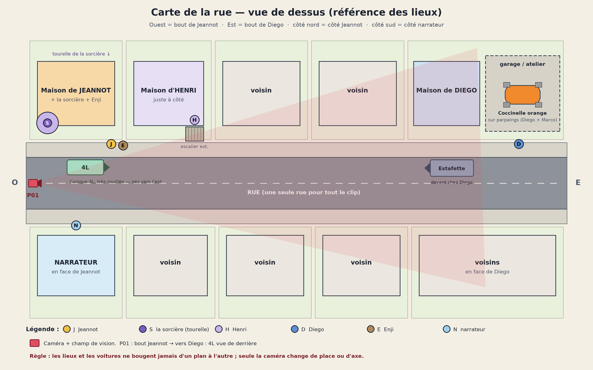

- 💬 *2026-10-11 11:13* — inverser la position de la maison et du garage de diego .
et repositionner l'estafette devant la maison. Il faut qu'on puisse avoir une vue dégagé du garage ouvert avec la coccinnelle dedans.

**CARTE · v2** — ✅ retenue — nouveau fil, d'après ton avis sur v1 (SVG : carte-rue-v2.svg)  
Garage/atelier de Diego et maison inversés : le garage (porte ouverte, Coccinelle sur parpaings) vient en premier côté ouest, la maison au bout. L'Estafette est garée devant la maison, donc rien ne bouche la vue sur le garage ouvert.

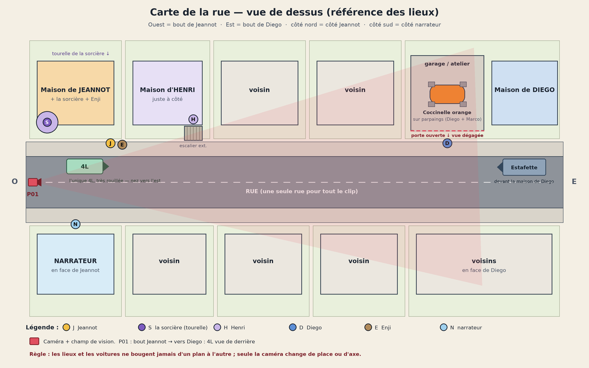

- 💬 *2026-10-11 11:25* — C'est bon ça servira de ref à la carte  interactive pour chaque plan que je t'ai demandé

## P01

**00:00–00:05** · Instrumental · 🛠️ En cours

> Plan général maître de la rue, avec avant-plan dégagé. Une 4L vert menthe unique, à échelle réaliste, reste sur l'asphalte au bord du trottoir gauche devant chez Jeannot ; l'Estafette bleu-gris est plus loin sur le même côté.

**P01 · v1** — ⏳ à valider — ancien fil, commit f1eccd4 (03h40)  
Add complete clip storyboard and opening frame

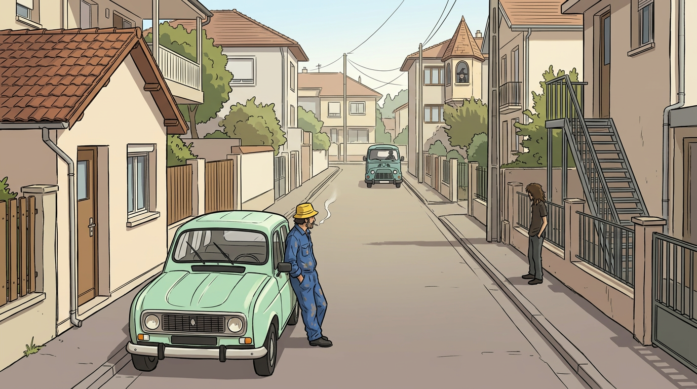

**P01 · v2** — ⏳ à valider — ancien fil, commit 068faf0 (03h48)  
Correct Estafette position in opening storyboard

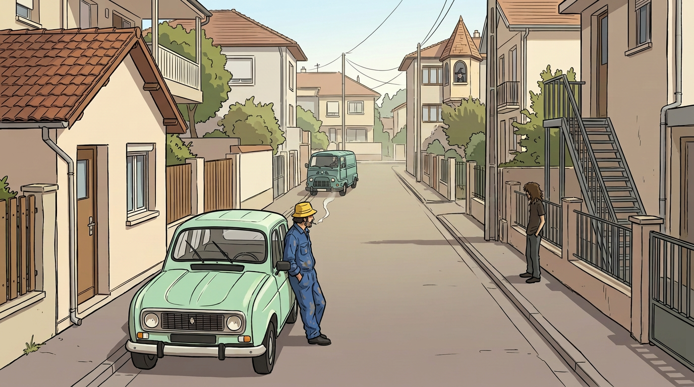

**P01 · v3** — ⏳ à valider — ancien fil, commit dda932f (06h01)  
Reframe P01 master with fixed realistic 4L placement — version en place dans le storyboard

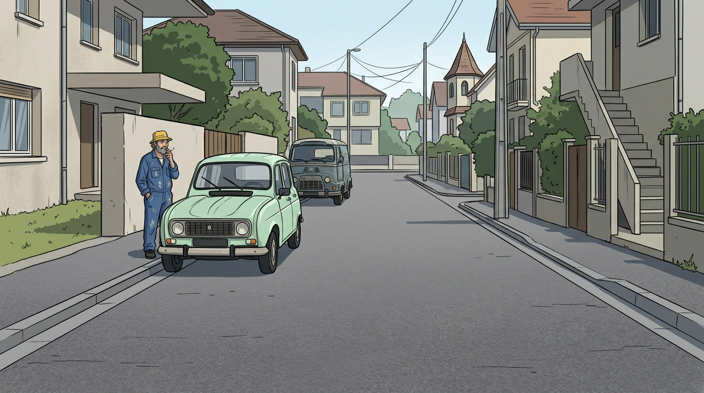

**P01 · v4** — 🔁 à retoucher — nouveau fil, généré le 11/10 à partir de v3 + photo de référence + style frame Jeannot  
Même géographie que v3 (4L unique contre le trottoir gauche, Estafette plus loin même côté, escalier d'Henri à droite, tourelle au fond) ; Jeannot sur le trottoir à côté de la 4L, cigarette avec un seul filet de fumée.

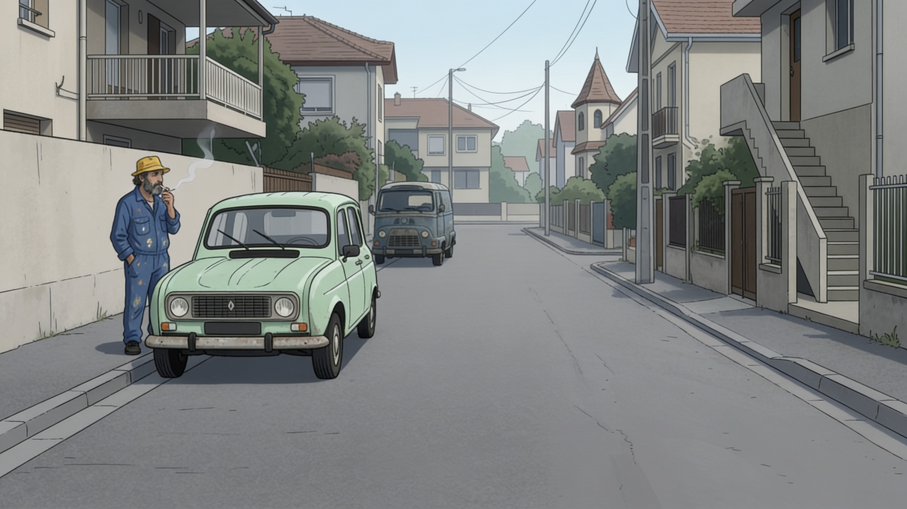

- 💬 *2026-10-11 10:58* — Je préfère la 4L vue de derrière (comme sur la photo de référence). Elle était aussi en moins bon état que sur cette version : plus rouillée, plus abîmée.

**P01 · v5** — ⏳ à valider — nouveau fil, généré le 11/10 d'après la carte v1 + photo de référence + style frame + v4  
4L vue de derrière, bien plus rouillée (comme la photo) ; tourelle sur la maison de Jeannot à gauche. À corriger si on la garde : l'escalier extérieur est à DROITE (côté narrateur) au lieu d'être sur la maison d'Henri à gauche ; l'Estafette est au milieu de la rue au lieu d'être devant chez Diego au fond ; format 3:2, à recadrer en 16:9.

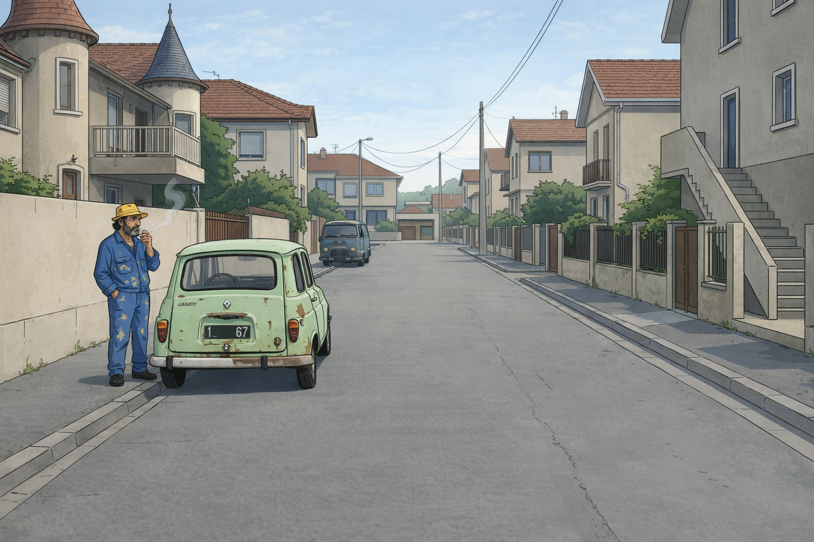

**P01 · v6** — 🔁 à retoucher — nouveau fil, retouche de v5 pour coller à la carte v1  
Comme v5 (4L vue de derrière, très rouillée, tourelle sur la maison de Jeannot) mais en 16:9 ; l'escalier extérieur est maintenant sur la maison d'Henri, juste après celle de Jeannot à gauche ; plus d'escalier à droite. Reste à vérifier : l'Estafette est bien au fond, mais plutôt au milieu de la chaussée qu'au bord gauche devant le garage de Diego.

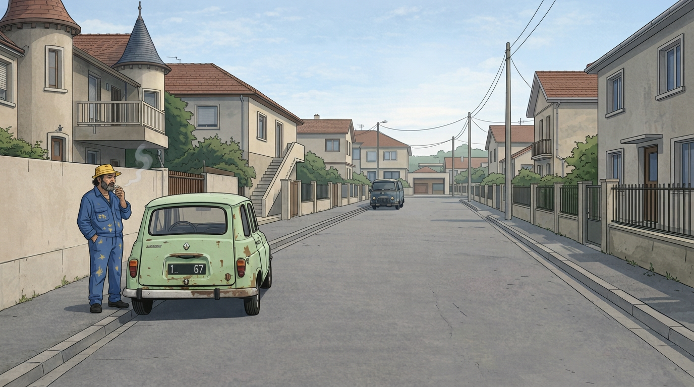

- 💬 *2026-10-11 11:14* — il faudra  prendre en compte  mon avis  de l'image de la carte
- 💬 *2026-10-11 11:15* — il faudra  prendre en compte  mon avis  de l'image de la carte  
Pour le garage de diego

**P01 · v7** — 🔁 à retoucher — nouveau fil, retouche de v6 avec la carte v2  
Comme v6, avec au fond le garage ouvert et la Coccinelle orange bien visible dedans. Écarts avec la carte : le garage est placé tout au bout, face à la rue (comme si la rue finissait sur chez Diego), au lieu d'être sur le côté gauche, et l'Estafette est au milieu de la chaussée au lieu d'être garée à gauche devant la maison. Recadrée en 16:9.

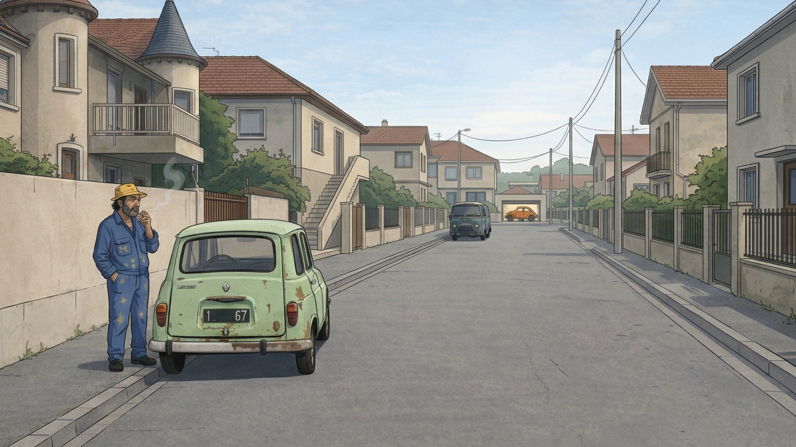

- 💬 *2026-10-11 11:26* — Pour  le garage je préfère  devant l'estafette  qu'on puisse juste distingué une ouverture  ça sera juste pour les plan  ou il faudra voir le garage  mais que ça soit cohérent avec la rue

**P01 · v8** — 🔁 à retoucher — nouveau fil, retouche de v6 d'après ton avis sur v7 (garage = simple ouverture, rue cohérente)  
La rue continue tout droit (elle ne finit plus sur le garage) ; on distingue juste une ouverture de garage sombre sur la gauche, sans voiture visible. Écarts avec la carte : le garage arrive trop tôt (juste après la maison d'Henri au lieu d'être après deux voisins), et l'Estafette est encore au milieu de la chaussée au lieu d'être garée à gauche devant la maison de Diego.

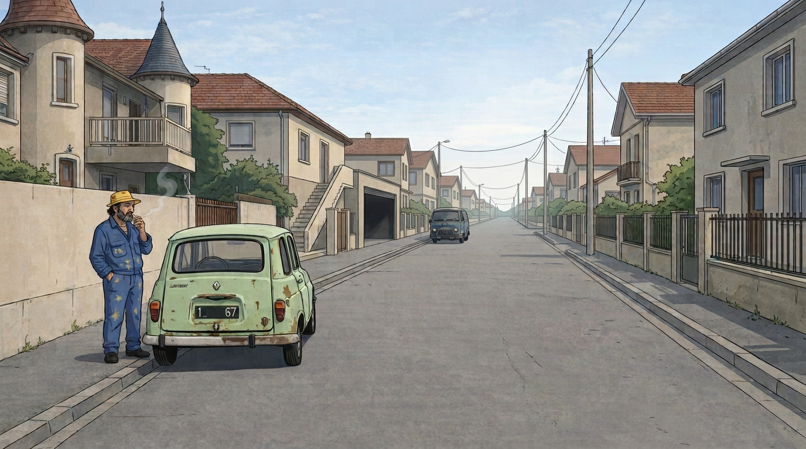

- 💬 *2026-10-11 11:50* — la rue se termine après l'estafette de diego  par un passage à niveau de train  elle descend ensuite donc on plus des collines au fond

## P02

**00:05–00:10** · Instrumental · ⏳ À valider

> Glissement vers la maison de Jeannot et sa 4L vert menthe, rouillée mais intacte. Jeannot respire, décale son poids et tient sa cigarette ; Enji traverse le cadre pour son gag.

**P02 · v1** — ⏳ à valider — ancien fil, commit 2db27a6 (03h55)  
Add P02 storyboard keyframe and progress tracker

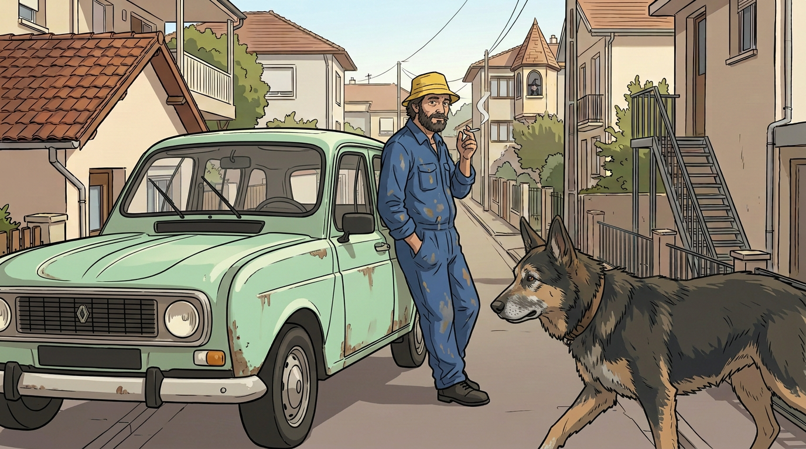

**P02 · v2** — ⏳ à valider — ancien fil, commit e2a3352 (06h33)  
Reframe P02 with fixed 4L continuity — version en place dans le storyboard

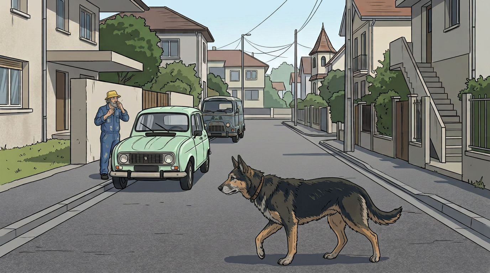

## P03

**00:10–00:16,35** · Instrumental · ⏳ À valider

> Pan vers la maison voisine et l'escalier d'Henri, puis vers la tourelle de la sorcière et l'autre bout de la rue où se trouve Diego. Finir le mouvement sur Jeannot, prêt pour la première entrée vocale.

**P03 · v1** — ⏳ à valider — ancien fil, commit 7bda9a7 (03h56)  
Add P03 street geography storyboard frame

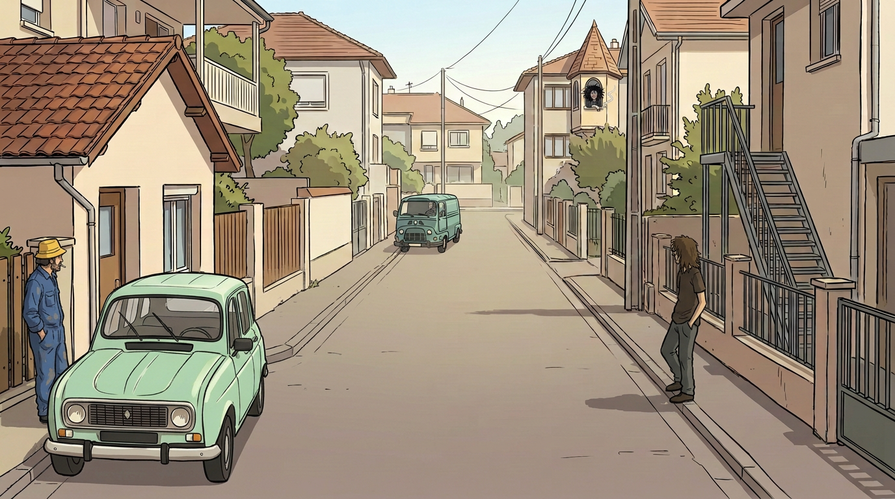

**P03 · v2** — ⏳ à valider — ancien fil, commit ea24889 (06h34)  
Reframe P03 with master street layout — version en place dans le storyboard

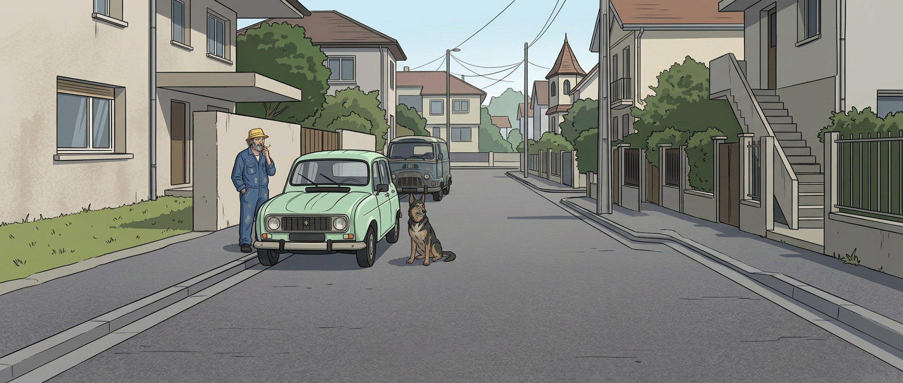

## P04

**00:16,35–00:18,88** · « Jeannot est là, et toujours là ! » · ⏳ À valider

> Plan moyen 3/4 de Jeannot près de la 4L. Il lève la cigarette vers la bouche, inspire ; épaules et torse bougent, puis il relâche son souffle. Une seule fumée évolue avec le geste. Léger push-in ; la 4L reste visible.

**P04 · v1** — ⏳ à valider — ancien fil, commit 36af4fe (03h57)  
Add P04 Jeannot performance storyboard frame — version en place dans le storyboard

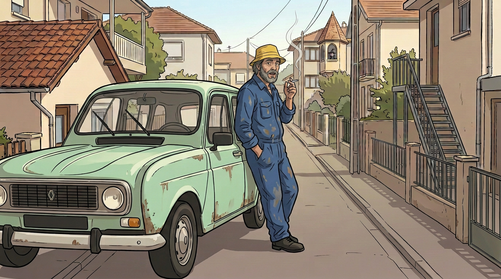

## P05

**00:18,88–00:21,42** · « La sorcière est partie, Jeannot est encore là » · ⏳ À valider

> La sœur descend de la tourelle et s'éloigne sur le trottoir droit, cigarette à la main, en tenant Enji en laisse. Jeannot reste près de son unique 4L, à l'emplacement fixe devant chez lui.

**P05 · v1** — ⏳ à valider — ancien fil, commit 1798b2b (03h57)  
Add P05 witch departure storyboard frame

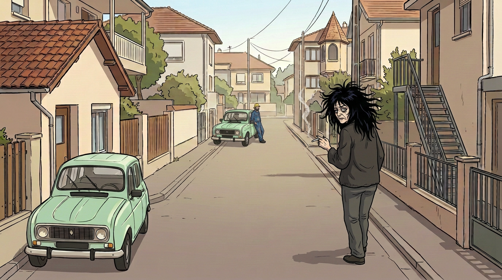

**P05 · v2** — ⏳ à valider — ancien fil, commit be42921 (05h28)  
Correct P05 car continuity and leash Enji

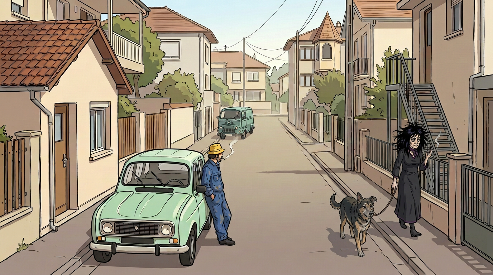

**P05 · v3** — ⏳ à valider — ancien fil, commit f1d2b39 (06h24)  
Reframe P05 around fixed 4L and leashed Enji — version en place dans le storyboard

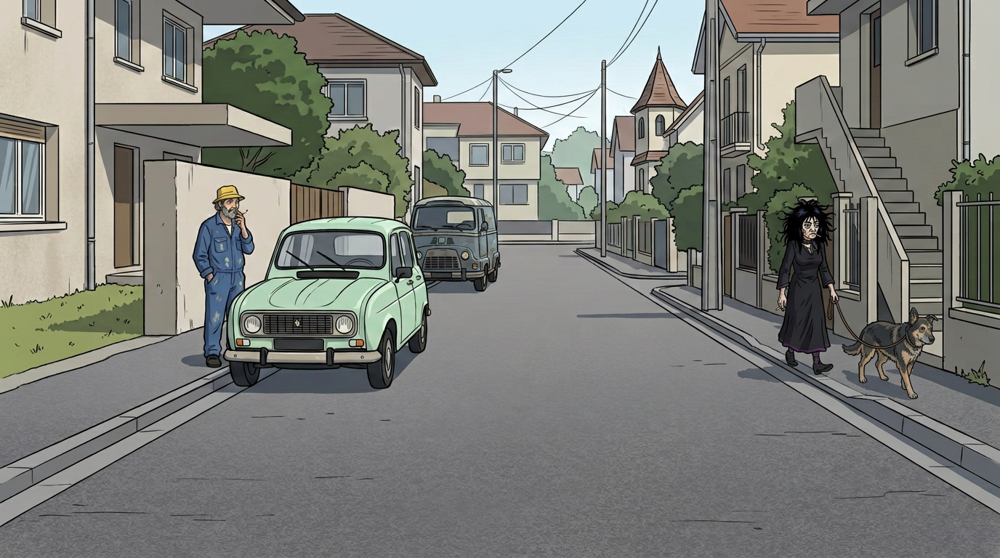

## P06

**00:21,42–00:23,95** · « Alors Henri s'enfuit, Jeannot est toujours là » · ⏳ À valider

> Plan latéral de course. Henri part de la maison voisine et traverse le haut des marches ; bras, épaules, tête et jambes ont des poses distinctes. Garder lunettes, cigarette et sourire lisibles.

**P06 · v1** — ⏳ à valider — ancien fil, commit 1529fa5 (03h58)  
Add P06 Henri running storyboard frame — version en place dans le storyboard

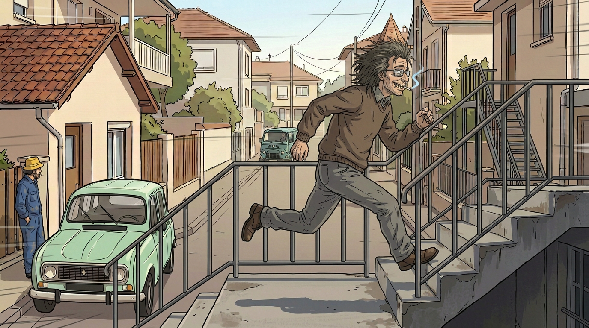

## P07

**00:23,95–00:26,48** · « La sorcière est revenue, c'est la merde dans la rue » · ⏳ À valider

> Whip-pan vers la tourelle ; la sorcière réapparaît, puis petit push-in sur son air fatigué. Réaction comique dans la rue, sans dialogue ni nouveau texte.

**P07 · v1** — ⏳ à valider — ancien fil, commit 45092df (03h59)  
Add P07 witch return storyboard frame — version en place dans le storyboard

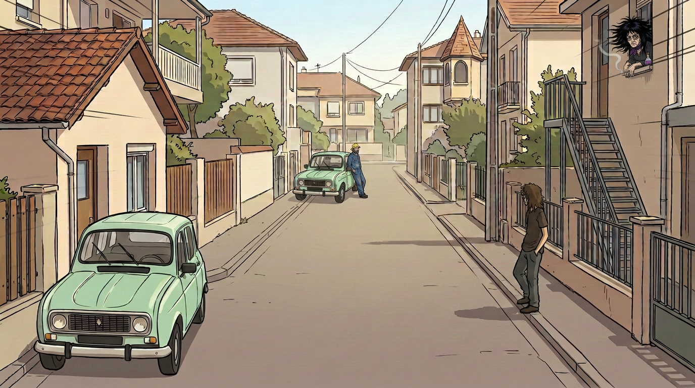

## P08

**00:26,48–00:29,02** · « Henri tombe des escaliers, toutes ses dents sont esquintées » · ⏳ À valider

> Tilt vers l'escalier et suivi continu : Henri perd pied, tente de se rattraper, pose main et genou sur une marche, glisse et finit assis en bas. Pas de salto ni rotation complète. Petit flash/poussière sur « dents », puis tenir son sourire aux dents ébréchées, sans gore ; Enji accourt sur le dernier temps.

**P08 · v1** — ⏳ à valider — ancien fil, commit 862007f (04h02)  
Add P08 Henri fall storyboard frame — version en place dans le storyboard

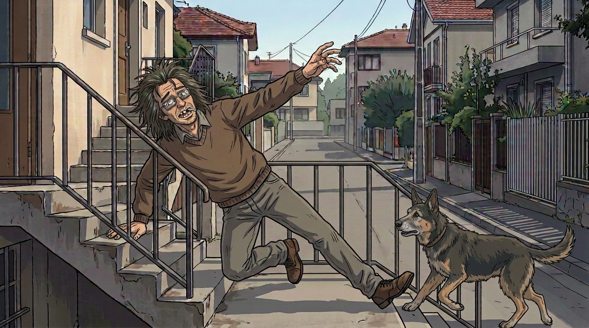

## P09

**00:29,02–00:31,47** · « Jeannot a gagné, Jeannot est toujours là » · ⏳ À valider

> Jeannot se redresse devant sa 4L et prend une pose héroïque ; flash bref et motif graphique récurrent. Aucun dommage à la voiture.

**P09 · v1** — ⏳ à valider — ancien fil, commit c00899b (04h03)  
Add P09 Jeannot victory storyboard frame — version en place dans le storyboard

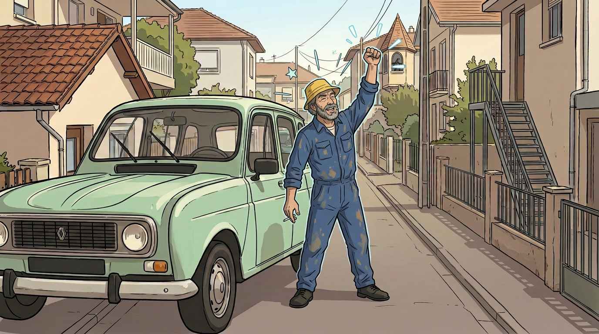

## P10

**00:31,47–00:33,91** · « Il ne partira pas, il restera là » · ⏳ À valider

> Gros plan de Jeannot, puis recul vers la maison entière. Il reste solidement ancré dans la rue ; aura encore discrète.

**P10 · v1** — ⏳ à valider — ancien fil, commit da041ab (04h11)  
Add P10 Jeannot stays storyboard frame — version en place dans le storyboard

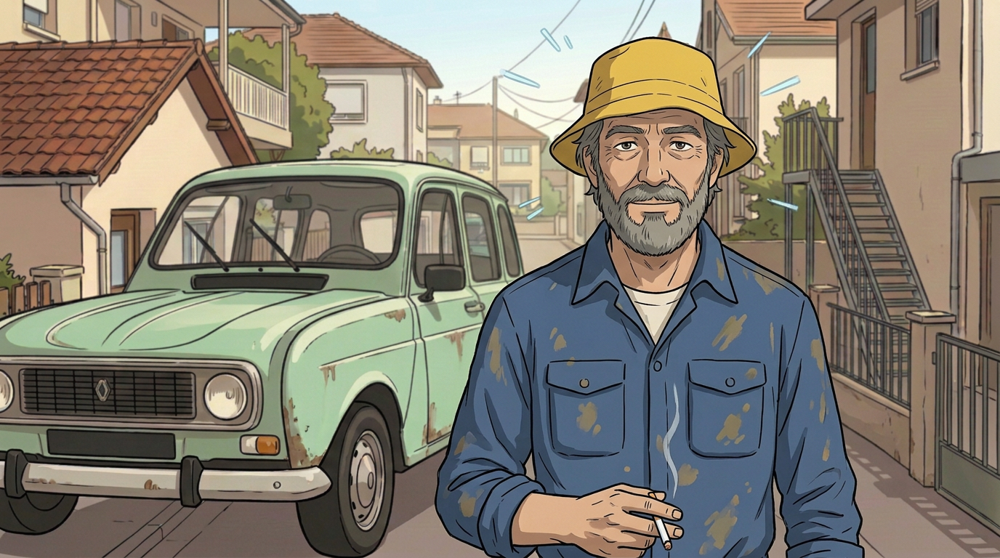

## P11

**00:33,91–00:36,36** · « La 4 ailes dans la rue, le bordel est revenu » · ⏳ À valider

> Plan sur la 4L depuis le même côté ; révéler sa forme carrée et sa rouille sans changer son emplacement ni son orientation. Léger frémissement comique possible, mais elle demeure intacte.

**P11 · v1** — ⏳ à valider — ancien fil, commit d87986c (04h12)  
Add P11 Renault 4L storyboard frame

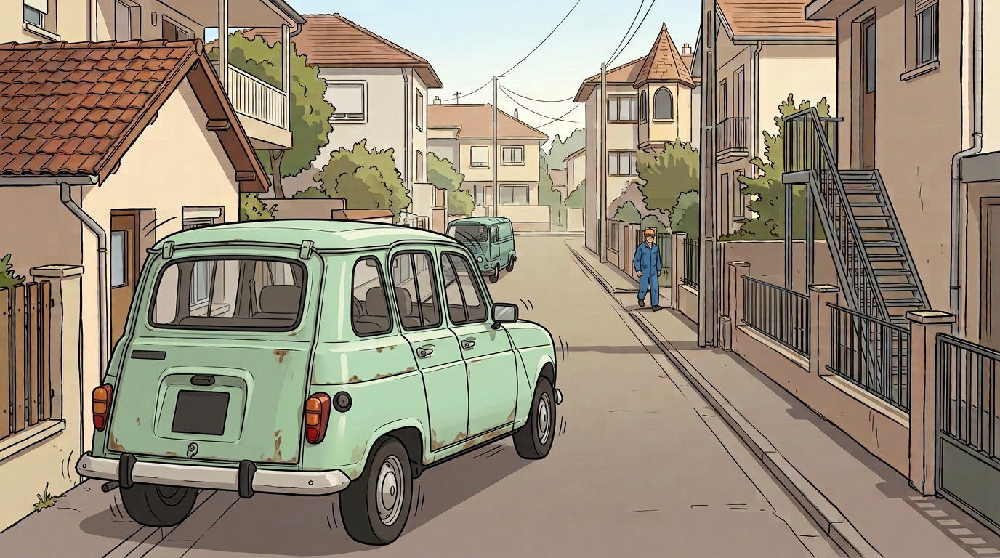

**P11 · v2** — ⏳ à valider — ancien fil, commit 676c4e3 (04h22)  
Lock Renault 4L position and correct P11 frame — version en place dans le storyboard

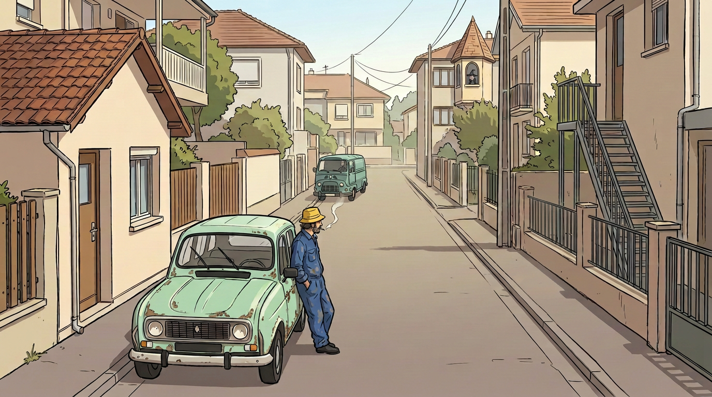

## P12

**00:36,36–00:38,80** · « Le rat guette, dans son estafette » · ⏳ À valider

> Plan large depuis l'extrémité de Jeannot : la 4L reste au premier plan à son emplacement fixe ; l'Estafette bleu-gris est plus loin sur le même trottoir gauche. « Le rat », c'est Diego : seule sa tête et un peu d'épaule dépassent de la fenêtre conducteur ; visage conforme au concept approuvé. Aucun doublon de voiture ni personnage supplémentaire.

**P12 · v1** — ⏳ à valider — ancien fil, commit 235f743 (04h13)  
Add P12 Diego in Estafette storyboard frame

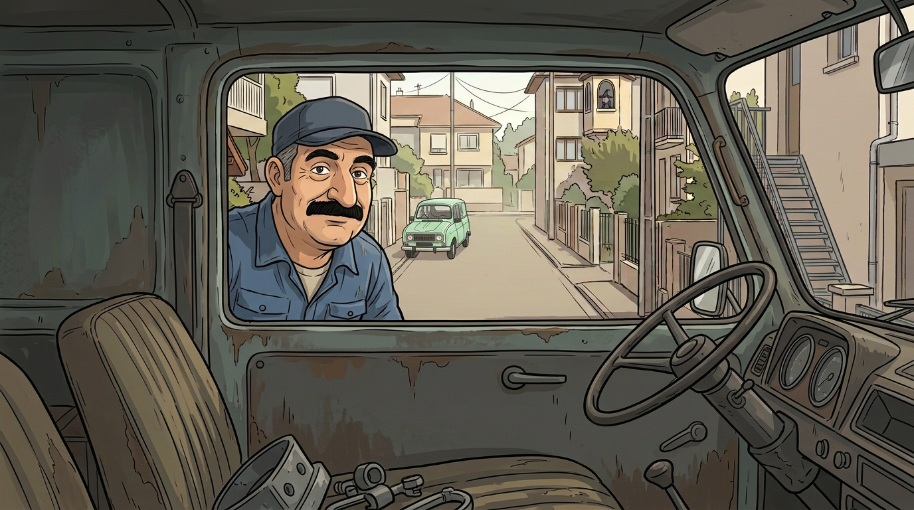

**P12 · v2** — ⏳ à valider — ancien fil, commit 486eb5b (06h22)  
Correct P12 Diego's peeking Estafette shot

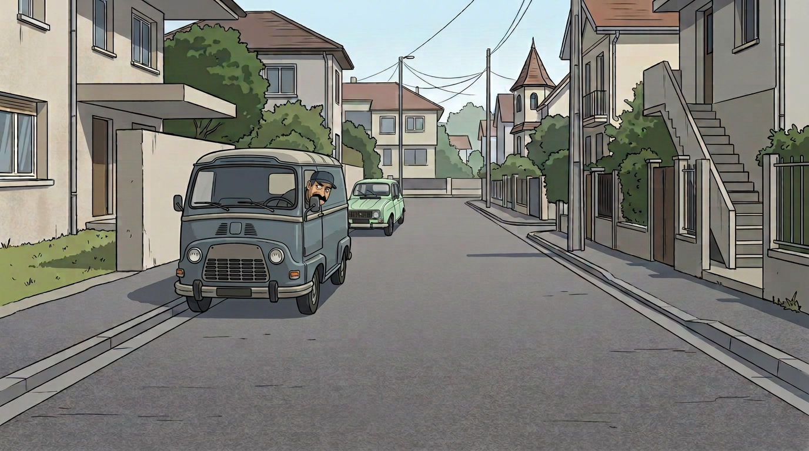

**P12 · v3** — ⏳ à valider — ancien fil, commit a43d5e7 (06h55)  
Correct P12 van and 4L depth order — version en place dans le storyboard

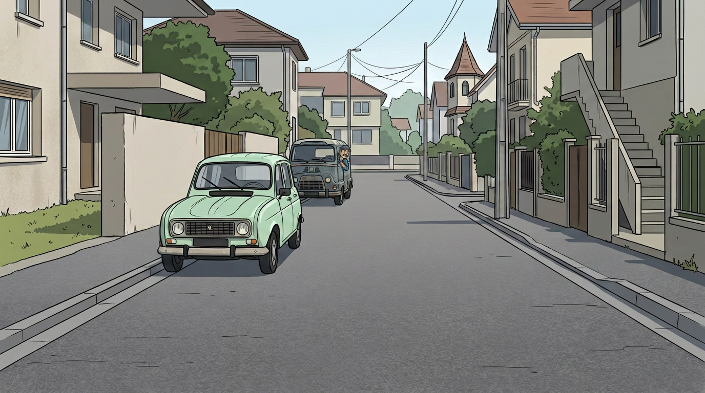

## P13

**00:38,80–00:41,25** · « La sorcière d'sa tourelle, attend son Roméo » · ⏳ À valider

> Contre-plongée sur la sorcière à sa fenêtre ; son regard suit Diego dans l'Estafette. Cigarette, mascara et fatigue restent lisibles.

**P13 · v1** — ⏳ à valider — ancien fil, commit 9599dff (04h14)  
Add P13 witch watching Diego storyboard frame — version en place dans le storyboard

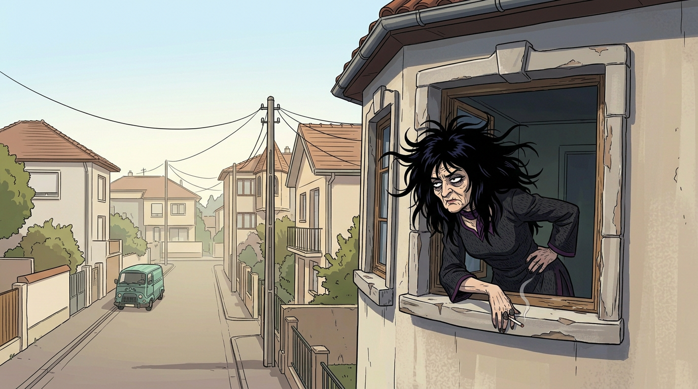

## P14

**00:41,25–00:43,69** · « Et le rat Diégo, casse la 4 ailes de Jeannot » · ⏳ À valider

> Diego provoque une secousse comique de la 4L : mouvement caméra et éclat « BAM » visuel. La tôle vibre, mais rien ne casse et la voiture ne se déforme pas.

**P14 · v1** — ⏳ à valider — ancien fil, commit 54c00b4 (04h14)  
Add P14 intact 4L comic shake storyboard frame — version en place dans le storyboard

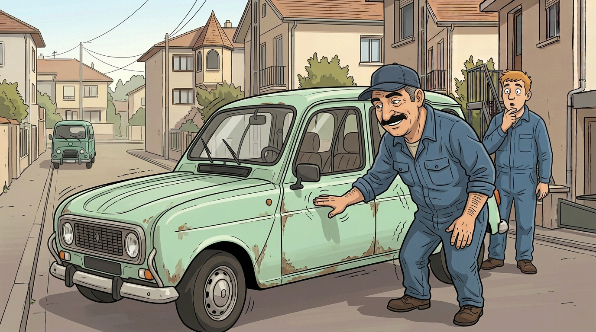

## P15

**00:43,69–00:50,35** · Instrumental / montée musicale · ⏳ À valider

> Travelling le long de la rue, de la 4L jusqu'à Diego. Les deux rivaux se font face de part et d'autre de la chaussée. La caméra se rapproche ; lignes d'énergie et aura montent au rythme, sans changer de lieu.

**P15 · v1** — ⏳ à valider — ancien fil, commit 6dc895b (04h15)  
Add P15 Diego and Jeannot fight standoff frame — version en place dans le storyboard

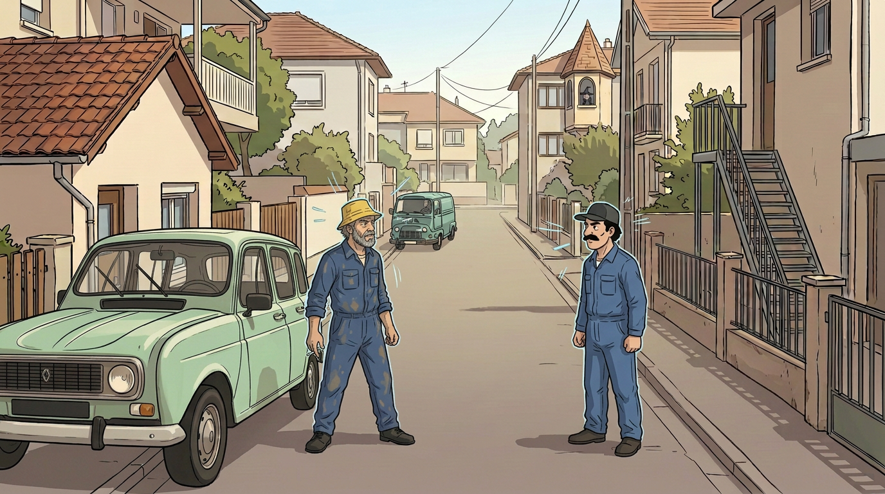

## P16

**00:50,35–00:53,70** · « C'est le combat final, entre Diego et Jeannot » · ⏳ À valider

> Cadrage frontal alterné sur Diego puis Jeannot ; terminer en plan large de l'axe de la rue. Fenêtre vocale à vérifier.

**P16 · v1** — ⏳ à valider — ancien fil, commit d281ff2 (04h16)  
Add P16 final combat announcement frame — version en place dans le storyboard

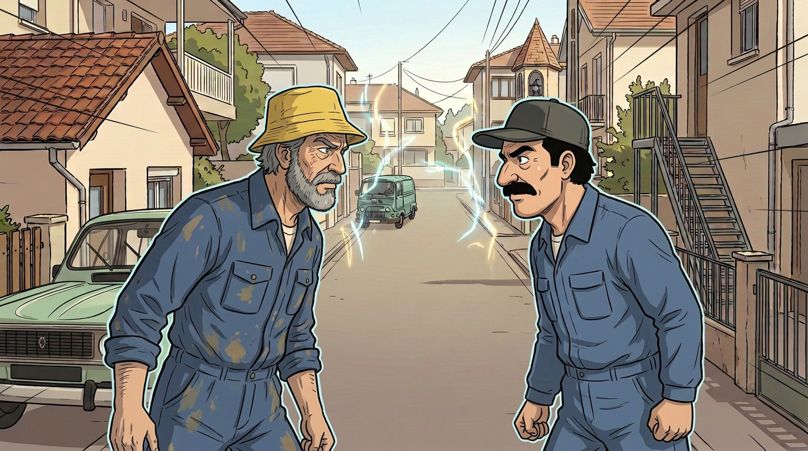

## P17

**00:53,70–00:57,24** · « Jeannot a gagné, Jeannot est toujours là » · ⏳ À valider

> Diego et Jeannot tournent autour l'un de l'autre ; Jeannot reprend l'avantage. Flash/cartouche récurrent sur l'accent musical.

**P17 · v1** — ⏳ à valider — ancien fil, commit 1a0012f (04h17)  
Add P17 Jeannot advantage storyboard frame — version en place dans le storyboard

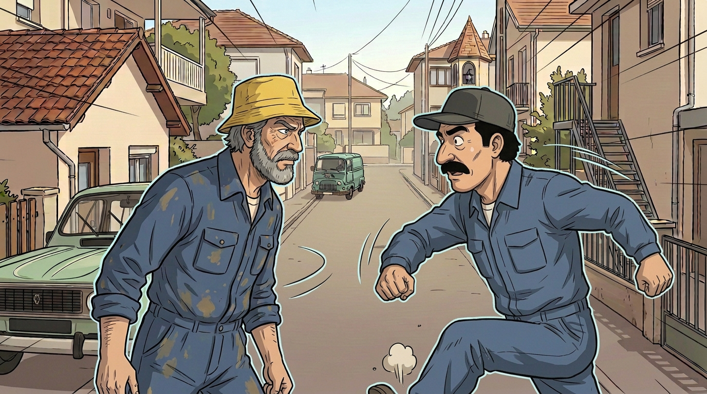

## P18

**00:57,24–01:00,78** · « Il ne partira pas, il restera là » · ⏳ À valider

> Transformation shōnen de Jeannot : cheveux qui se dressent, aura et lignes de vitesse. Conserver chapeau, combinaison tachée et cigarette comme motifs ; rester dans la rue.

**P18 · v1** — ⏳ à valider — ancien fil, commit 96de1c3 (04h44)  
Add P18 Jeannot power-up storyboard frame — version en place dans le storyboard

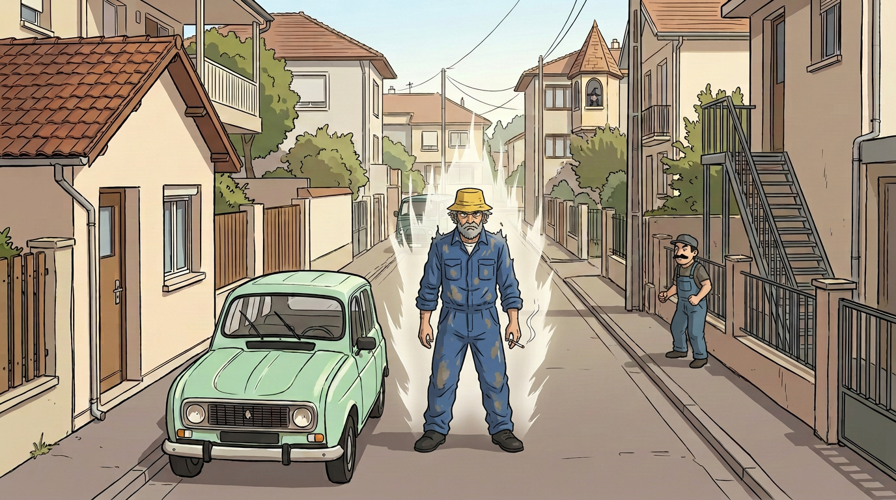

## P19

**01:00,78–01:03,99** · « Jeannot tape Diego, qui se casse le dos » · ⏳ À valider

> Gag d'action stylisé : bourrasque d'aura, Diego se déséquilibre comiquement, sans blessure réaliste ni gore.

**P19 · v1** — ⏳ à valider — ancien fil, commit 7114680 (04h47)  
Add P19 comic recoil storyboard frame — version en place dans le storyboard

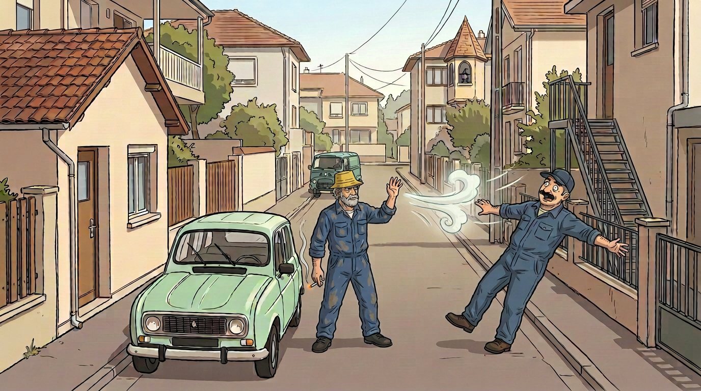

## P20

**01:03,99–01:07,53** · « Diégo est à terre, c'est la fin de la guerre » · ⏳ À valider

> Diego se retrouve au sol, sonné mais indemne. Enji renifle sa casquette ou lui tourne autour ; gag muet, pas de dialogue.

**P20 · v1** — ⏳ à valider — ancien fil, commit 8af880a (04h48)  
Add P20 Diego and Enji storyboard frame — version en place dans le storyboard

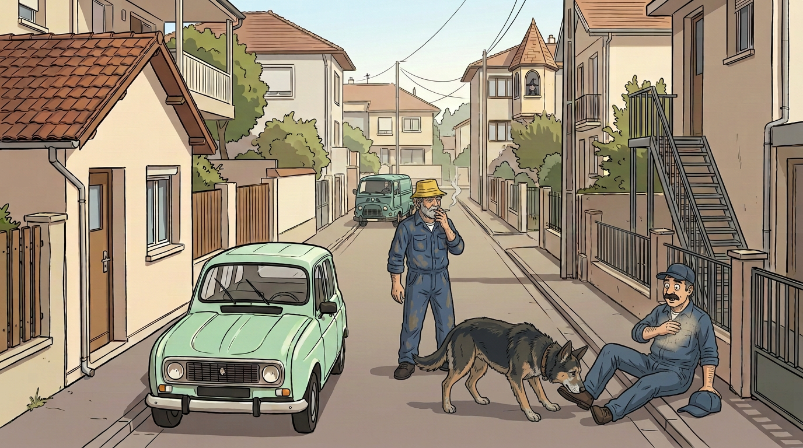

## P21

**01:07,53–01:11,71** · « Jeannot prend sa peinture, et la verse sur la voiture » · ⏳ À valider

> Jeannot saisit son pot et le lève comme une boule d'énergie, puis amorce le geste de verser. Coupe dans le mouvement vers la Coccinelle orange de Marco ; ne pas viser la 4L.

**P21 · v1** — ⏳ à valider — ancien fil, commit 7e5dc32 (04h50)  
Add P21 Jeannot paint-can storyboard frame — version en place dans le storyboard

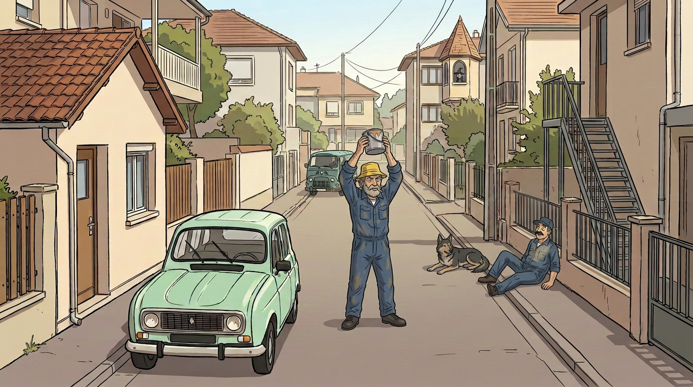

## P22

**01:11,71–01:14,92** · « du fils de Diégo, qui s'appelle Marco » · ⏳ À valider

> Révéler la Coccinelle orange sur parpaings, en restauration : capot ouvert, roue déposée, outils et pièces à proximité. La peinture touche la carrosserie comme gag visuel ; Diego et Marco sont clairement associés à cette voiture. Le design détaillé de Marco reste à définir.

**P22 · v1** — ⏳ à valider — ancien fil, commit 449d450 (05h05)  
Add P22 Marco Beetle paint storyboard frame — version en place dans le storyboard

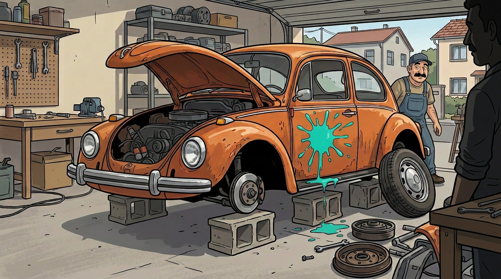

## P23

**01:14,92–01:18,13** · « Diégo a perdu, Jeannot a gagné » · ⏳ À valider

> Retour à la rue. Diego reste au sol un instant, Jeannot se relève et reprend sa pose de héros ; Enji traverse le cadre. La 4L et l'Estafette restent à leur place fixe.

**P23 · v1** — ⏳ à valider — ancien fil, commit 1815a67 (05h07)  
Add P23 victory return with fixed car continuity — version en place dans le storyboard

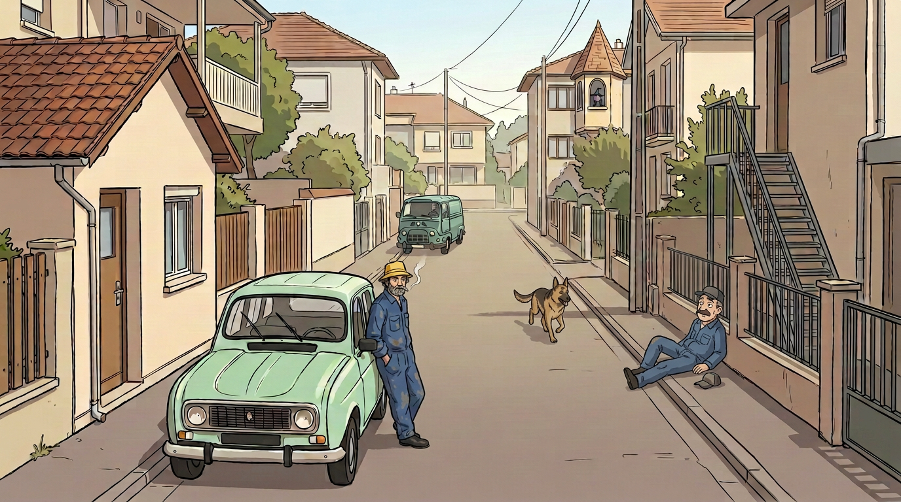

## P24

**01:18,13–01:22,00** · « C'est le roi de la rue, et il nous casse les pieds » · ⏳ À valider

> Pose de Jeannot au milieu de la rue. Réactions exaspérées aux fenêtres et gag d'Enji ; aucun dialogue ajouté. La 4L et l'Estafette restent à leur place.

**P24 · v1** — ⏳ à valider — ancien fil, commit 673edd5 (05h09)  
Add P24 king of the street storyboard frame — version en place dans le storyboard

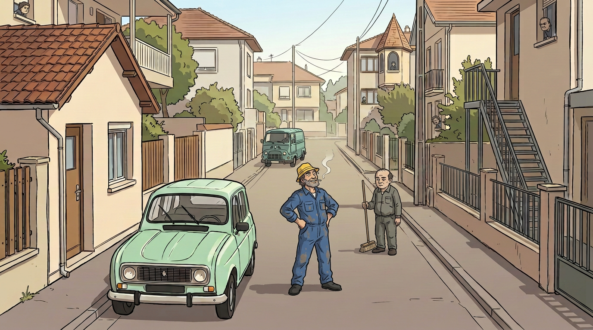

## P25

**01:22,00–01:25,70** · Instrumental · ⏳ À valider

> Tenir la victoire, laisser retomber aura et poussière, puis recadrer Jeannot au premier accent du refrain final. La 4L et l'Estafette gardent leurs emplacements fixes.

**P25 · v1** — ⏳ à valider — ancien fil, commit 0282de3 (05h10)  
Add P25 victory breathing storyboard frame — version en place dans le storyboard

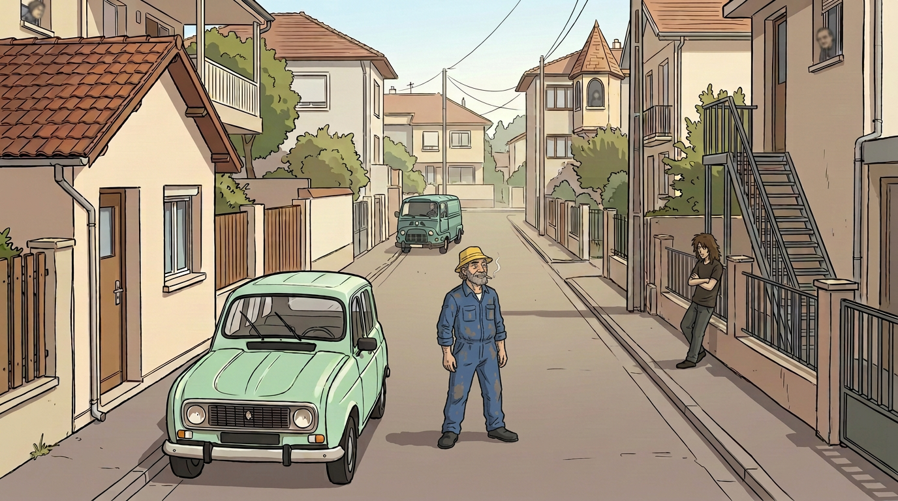

## P26

**01:25,70–01:29,45** · « Jeannot a gagné, Jeannot est toujours là » · ⏳ À valider

> Reprise du motif de victoire, en plan plus large qui inclut la 4L entière. Flash bref ; voitures à leurs emplacements fixes.

**P26 · v1** — ⏳ à valider — ancien fil, commit d0c978c (05h12)  
Add P26 final chorus storyboard frame — version en place dans le storyboard

## P27

**01:29,45–01:33,20** · « Il ne partira pas, il restera là » · ⏳ À valider

> Jeannot reste devant sa maison ; respiration et posture se calment, l'aura s'éteint. La 4L et l'Estafette gardent exactement leurs emplacements fixes.

**P27 · v1** — ⏳ à valider — ancien fil, commit 8eb1389 (05h20)  
Add P27 Jeannot remains storyboard frame — version en place dans le storyboard

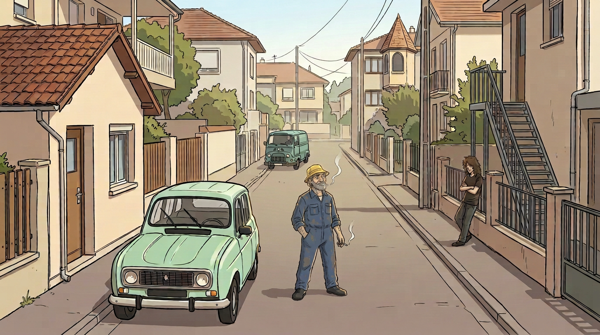

## P28

**01:33,20–01:37,00** · « Fin » · ⏳ À valider

> Fond de carton sur le dernier accent vocal, avec espace réservé au titre exact « Fin » pour l'étape d'annotation ; maintien bref, à recaler sur la voix réelle. Les deux voitures gardent leurs emplacements fixes.

**P28 · v1** — ⏳ à valider — ancien fil, commit 129bef2 (05h22)  
Add P28 closing title-card storyboard frame — version en place dans le storyboard

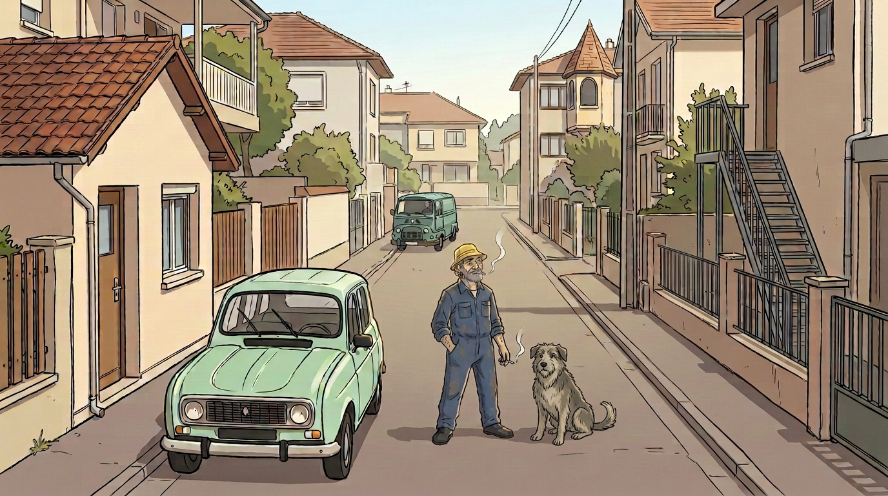

## P29

**01:37,00–01:44,36** · Instrumental / réverbération · ⏳ À valider

> Tenir la dernière pose et la rue, puis fondu au noir à la fin du MP3. Aucun texte supplémentaire ; la 4L et l'Estafette conservent leurs repères fixes.

**P29 · v1** — ⏳ à valider — ancien fil, commit 4e4650b (05h23)  
Add P29 final outro storyboard frame — version en place dans le storyboard

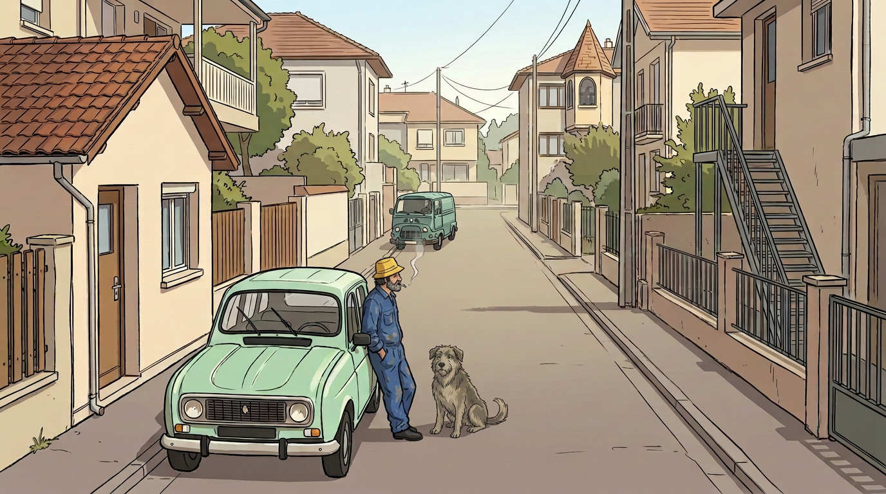

