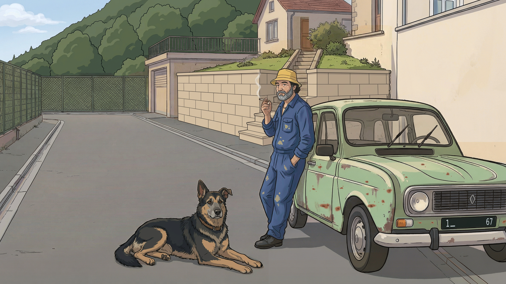
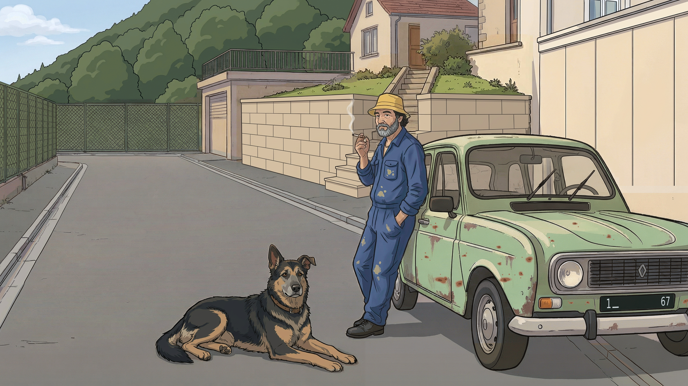
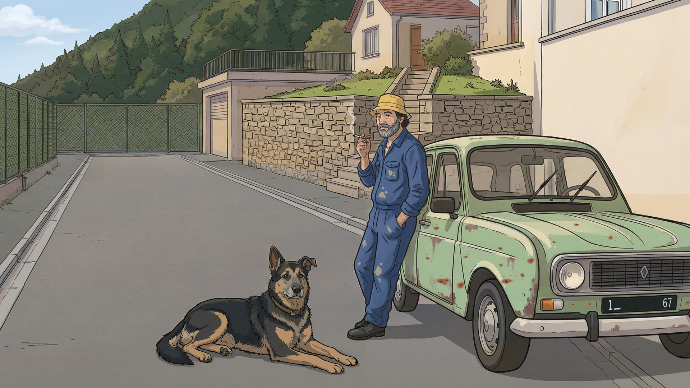
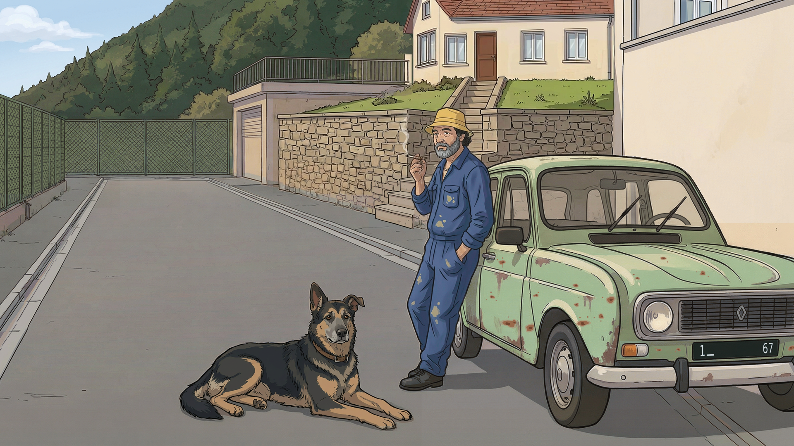
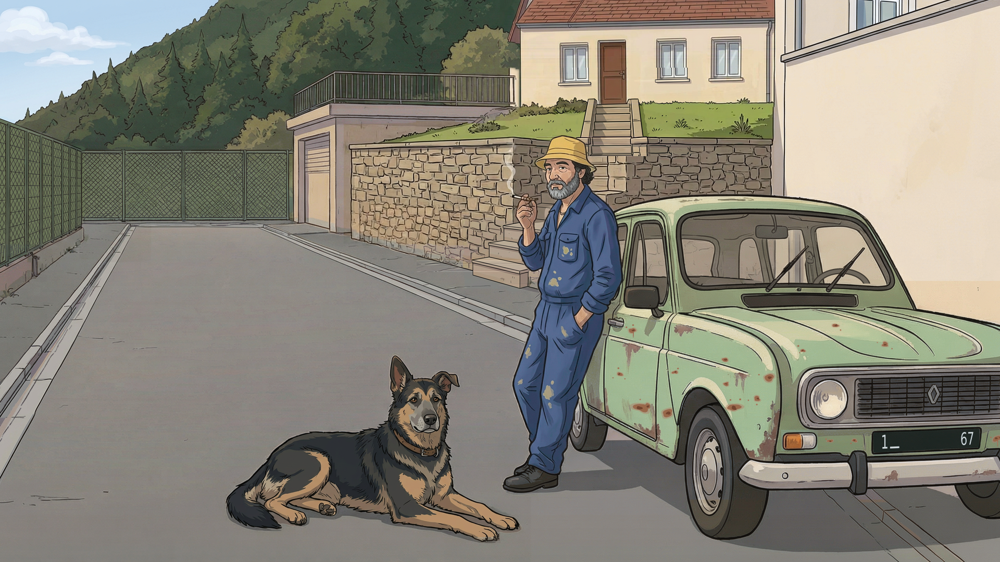
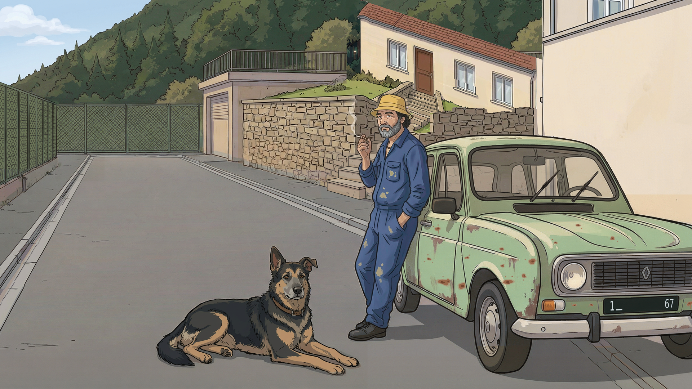
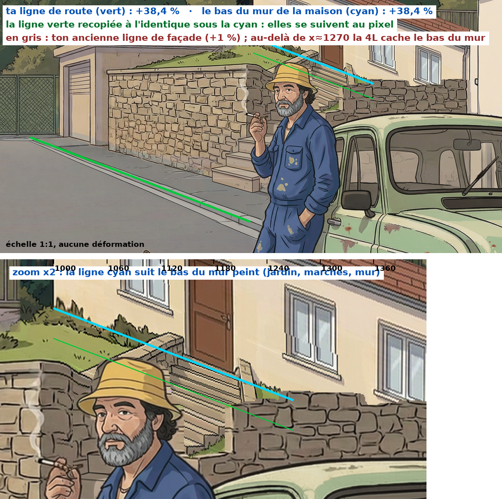
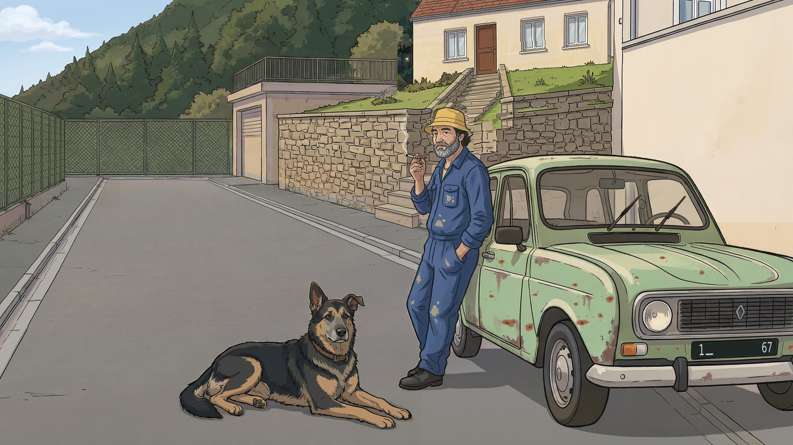
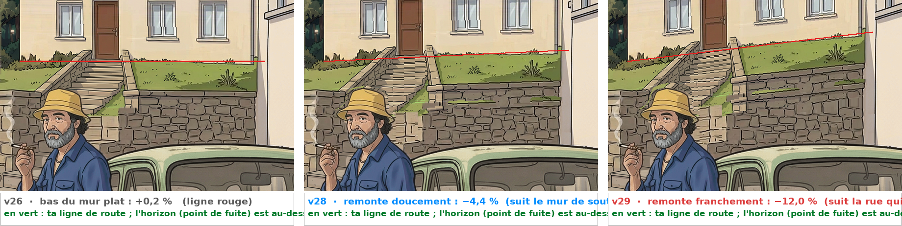

# Storyboard — options à valider

Tri plan par plan. **Toutes les options sont conservées ici** (anciennes versions récupérées dans l'historique Git + nouvelles propositions), pour ne rien perdre si un fil plante.

- Fichier source : [`assets/storyboards/a-valider/options.json`](../assets/storyboards/a-valider/options.json)
- Page de comparaison avec avis : lancer `python3 tools/serve_storyboard.py` puis ouvrir `/storyboard/a-valider.html`
- Régénérer ce fichier : `python3 tools/build_a_valider.py`

## Avancement

| Plan | Temps | Statut | Options | Choix |
|---|---:|---|---:|---|
| [CARTE](#carte) | référence | ✅ Validé | 10 | v10 |
| [P01](#p01) | 00:00–00:05 | ✅ Validé | 28 | v33 |
| [P02](#p02) | 00:05–00:10 | ⏳ À valider | 31 | — |
| [P03](#p03) | 00:10–00:16,35 | ⏳ À valider | 2 | — |
| [P04](#p04) | 00:16,35–00:18,88 | ⏳ À valider | 1 | — |
| [P05](#p05) | 00:18,88–00:21,42 | ⏳ À valider | 3 | — |
| [P06](#p06) | 00:21,42–00:23,95 | ⏳ À valider | 1 | — |
| [P07](#p07) | 00:23,95–00:26,48 | ⏳ À valider | 1 | — |
| [P08](#p08) | 00:26,48–00:29,02 | ⏳ À valider | 1 | — |
| [P09](#p09) | 00:29,02–00:31,47 | ⏳ À valider | 1 | — |
| [P10](#p10) | 00:31,47–00:33,91 | ⏳ À valider | 1 | — |
| [P11](#p11) | 00:33,91–00:36,36 | ⏳ À valider | 2 | — |
| [P12](#p12) | 00:36,36–00:38,80 | ⏳ À valider | 3 | — |
| [P13](#p13) | 00:38,80–00:41,25 | ⏳ À valider | 1 | — |
| [P14](#p14) | 00:41,25–00:43,69 | ⏳ À valider | 1 | — |
| [P15](#p15) | 00:43,69–00:50,35 | ⏳ À valider | 1 | — |
| [P16](#p16) | 00:50,35–00:53,70 | ⏳ À valider | 1 | — |
| [P17](#p17) | 00:53,70–00:57,24 | ⏳ À valider | 1 | — |
| [P18](#p18) | 00:57,24–01:00,78 | ⏳ À valider | 1 | — |
| [P19](#p19) | 01:00,78–01:03,99 | ⏳ À valider | 1 | — |
| [P20](#p20) | 01:03,99–01:07,53 | ⏳ À valider | 1 | — |
| [P21](#p21) | 01:07,53–01:11,71 | ⏳ À valider | 1 | — |
| [P22](#p22) | 01:11,71–01:14,92 | ⏳ À valider | 1 | — |
| [P23](#p23) | 01:14,92–01:18,13 | ⏳ À valider | 1 | — |
| [P24](#p24) | 01:18,13–01:22,00 | ⏳ À valider | 1 | — |
| [P25](#p25) | 01:22,00–01:25,70 | ⏳ À valider | 1 | — |
| [P26](#p26) | 01:25,70–01:29,45 | ⏳ À valider | 1 | — |
| [P27](#p27) | 01:29,45–01:33,20 | ⏳ À valider | 1 | — |
| [P28](#p28) | 01:33,20–01:37,00 | ⏳ À valider | 1 | — |
| [P29](#p29) | 01:37,00–01:44,36 | ⏳ À valider | 1 | — |

## CARTE

**référence** · Carte des lieux (vue de dessus) · ✅ Validé · choix : **v10**

> Référence de cohérence pour tous les plans. Une seule rue ouest→est. Côté nord (côté Jeannot), d'ouest en est : maison de Jeannot avec la tourelle de la sorcière (elle vit chez Jeannot, avec Enji), maison d'Henri juste à côté avec son escalier extérieur, voisins, puis maison de Diego et son garage/atelier avec la Coccinelle orange sur parpaings. Côté sud : le narrateur en face de Jeannot, puis des voisins. L'unique 4L, très rouillée, est garée contre le trottoir nord devant chez Jeannot, nez vers l'est (vers Diego) ; l'Estafette est garée devant chez Diego. Chaque plan validé y reçoit sa caméra et son champ de vision.

**CARTE · v10** — ✅ retenue — tools/draw_street_map.py base v10 (lieux rév. 12)  
D'après ton message sur les nouveaux lieux : la maison du fond est élargie jusqu'à la limite de chez Jeannot ; le garage avec la terrasse dessus passe à l'ouest et le jardin surélevé à l'est ; un portail sur le trottoir ouvre sur un escalier qui monte à la maison et coupe le jardin en deux. Tout le reste est identique à la v9 (vérifié au pixel près).

🗄️ 9 option(s) écartée(s) : v1, v2, v3, v4, v5, v6, v7, v8, v9

- **v1** — nouveau fil, dessinée par script (tools/draw_street_map.py), version SVG à côté : carte-rue-v1.svg — ../assets/storyboards/a-valider/carte/carte-rue-v1.png
  - 💬 *2026-10-11 11:13* — inverser la position de la maison et du garage de diego .
et repositionner l'estafette devant la maison. Il faut qu'on puisse avoir une vue dégagé du garage ouvert avec la coccinnelle dedans.
- **v2** — nouveau fil, d'après ton avis sur v1 (SVG : carte-rue-v2.svg) — ../assets/storyboards/a-valider/carte/carte-rue-v2.png
  - 💬 *2026-10-11 11:25* — C'est bon ça servira de ref à la carte  interactive pour chaque plan que je t'ai demandé
  - 💬 *2026-10-13 09:58* — il faut que la tourelle soit à la droite de la maison  c'est le coté opposé
- **v3** — tools/draw_street_map.py base v3 (lieux rév. 5) — ../assets/storyboards/a-valider/carte/carte-rue-v3.png
- **v4** — tools/draw_street_map.py base v4 (lieux rév. 6) — ../assets/storyboards/a-valider/carte/carte-rue-v4.png
  - 💬 *2026-10-13 11:54* — le garage doit être aligné au fond des 2 autres maisons et l ouverture de celui-ci doit être alignée au début du trottoir ou à l escalier d Henri (c est le même résultat). (avis transmis dans le chat : l envoi avait échoué)
- **v5** — tools/draw_street_map.py base v5 (lieux rév. 7) — ../assets/storyboards/a-valider/carte/carte-rue-v5.png
- **v6** — tools/draw_street_map.py base v6 (lieux rév. 8) — ../assets/storyboards/a-valider/carte/carte-rue-v6.png
- **v7** — tools/draw_street_map.py base v7 (lieux rév. 9) — ../assets/storyboards/a-valider/carte/carte-rue-v7.png
- **v8** — tools/draw_street_map.py base v8 (lieux rév. 10) — ../assets/storyboards/a-valider/carte/carte-rue-v8.png
- **v9** — tools/draw_street_map.py base v9 (lieux rév. 11) — ../assets/storyboards/a-valider/carte/carte-rue-v9.png

## P01

**00:00–00:05** · Instrumental · ✅ Validé · choix : **v33**

> Plan général maître de la rue, avec avant-plan dégagé. Une 4L vert menthe unique, à échelle réaliste, reste sur l'asphalte au bord du trottoir gauche devant chez Jeannot ; l'Estafette bleu-gris est plus loin sur le même côté.

🗺️ Carte du plan (rév. 15, 2026-10-14 15:25) :

**P01 · v33** — ✅ retenue — tools/p01_v33.py — la v32 ; les collages de la v16 (capot ouvert, outils au sol) et de la v17 (fond autour de Diego) refaits à l'identique mais sans l'adoucissement de l'ancien contrôle, sans IA · contrôle : tools/controle_retouche.py → p01-v33-controle.jpg · 🟢 conforme à la carte actuelle (rév. 15)  
La v32 sans les restes de flou que tu as pointés autour de Diego (zone 1-2-3-4). Ils venaient bien de l'ancien contrôle : à l'époque, son critère « grain » faisait adoucir les collages. Le capot ouvert, le compartiment moteur et les outils au sol (v16), puis tout le fond autour de Diego (clôture, piliers, haie, v17) avaient été collés volontairement flous. La v20 avait rendu nets Diego, sa caisse et l'Estafette, mais pas ces deux collages-là. Je les ai refaits à l'identique, avec les mêmes images d'origine, mais sans flou : rien n'est redessiné, seul le flou disparaît. Tout le reste est exactement la v32, Henri d'ed5 compris. Contrôle CONFORME (couleurs 97 %, netteté ×1,05, raccord 0,0).

- 💬 *2026-10-14 15:17* — C'est ok quand le storyboard sera terminé  il faudra upscale l'image pour faire du 1080p en augmentant la qualité et les détails de l'image sans la changer . LA après avoir mis à jour la position d'henri sur la carte  on peut passer à la P02 enfin  , on se base évidant avec la P01 pour la réf de l'image  en tenant comptes des indications de la p02 pour la position des perso voiture et caméra

🗄️ 27 option(s) écartée(s) : v1, v2, v3, v4, v5, v6, v7, v8, v9, v10, v11, v12, v13, v16, v17, v18, v19, v20, v24, v25, v26, v27, v28, v29, v30, v31, v32

- **v1** — ancien fil, commit f1eccd4 (03h40) — ../assets/storyboards/a-valider/p01/p01-v1-ancien-fil-03h40.png
- **v2** — ancien fil, commit 068faf0 (03h48) — ../assets/storyboards/a-valider/p01/p01-v2-ancien-fil-03h48.png
- **v3** — ancien fil, commit dda932f (06h01) — ../assets/storyboards/a-valider/p01/p01-v3-ancien-fil-06h01.png
- **v4** — nouveau fil, généré le 11/10 à partir de v3 + photo de référence + style frame Jeannot — ../assets/storyboards/a-valider/p01/p01-v4-nouveau.png
  - 💬 *2026-10-11 10:58* — Je préfère la 4L vue de derrière (comme sur la photo de référence). Elle était aussi en moins bon état que sur cette version : plus rouillée, plus abîmée.
- **v5** — nouveau fil, généré le 11/10 d'après la carte v1 + photo de référence + style frame + v4 — ../assets/storyboards/a-valider/p01/p01-v5-nouveau.png
- **v6** — nouveau fil, retouche de v5 pour coller à la carte v1 — ../assets/storyboards/a-valider/p01/p01-v6-nouveau.png
  - 💬 *2026-10-11 11:14* — il faudra  prendre en compte  mon avis  de l'image de la carte
  - 💬 *2026-10-11 11:15* — il faudra  prendre en compte  mon avis  de l'image de la carte  
Pour le garage de diego
- **v7** — nouveau fil, retouche de v6 avec la carte v2 — ../assets/storyboards/a-valider/p01/p01-v7-nouveau.png
  - 💬 *2026-10-11 11:26* — Pour  le garage je préfère  devant l'estafette  qu'on puisse juste distingué une ouverture  ça sera juste pour les plan  ou il faudra voir le garage  mais que ça soit cohérent avec la rue
- **v8** — nouveau fil, retouche de v6 d'après ton avis sur v7 (garage = simple ouverture, rue cohérente) — ../assets/storyboards/a-valider/p01/p01-v8-nouveau.png
  - 💬 *2026-10-11 11:50* — la rue se termine après l'estafette de diego  par un passage à niveau de train  elle descend ensuite donc on plus des collines au fond
- **v9** — nouveau fil, générée d'après ta carte P01 rév. 1 + v8 (style) + photo de référence — ../assets/storyboards/a-valider/p01/p01-v9-carte-rev1.png
  - 💬 *2026-10-11 12:08* — (remarque donnée dans le chat) J’ai choisi l’image du passage à niveau. Il faut qu’il soit ouvert, avec les rails de chemin de fer entre les 2 barrières, sinon c’est bizarre juste la route. Après, la route descend à 45°, on ne la voit plus.
- **v10** — nouveau fil, retouche de v9 d'après ta carte P01 rév. 2 (+ fiche d'Enji) — ../assets/storyboards/a-valider/p01/p01-v10-carte-rev2.png
- **v11** — nouveau fil, retouche de v10 d'après ta carte P01 rév. 4 (lieux rév. 3) — ../assets/storyboards/a-valider/p01/p01-v11-carte-rev4.png
  - 💬 *2026-10-11 12:24* — depuis  l'ajout du passage à niveau le style de dessin à changer ce n'est plus pareil  et jeannot et les perso sont different aussi on dirait que c'est pas le même ia qui a généré , il faut revenir au style d'avant et vérifier les cohérences  ça srait bien d'enlever les images écarter   du storyboard à valider
- **v12** — nouveau fil, retouche de v8 (retour au style d'avant le passage à niveau) d'après ta carte P01 rév. 4 — ../assets/storyboards/a-valider/p01/p01-v12-style-v8-rev4.png
  - 💬 *2026-10-11 12:40* — le fond de la rue n'est plus bon il faut reprendre celui de la V11 vérifier que henri ressemble bien à henri  ce qui n'est pas du tout le cas de même pour Diego au fond
- **v13** — nouveau fil, montage : v12 (style v8) + fond de rue de v11, Henri et Diego refaits d'après leurs fiches, carte P01 rév. 5 — ../assets/storyboards/a-valider/p01/p01-v13-montage-rev5.png
  - 💬 *2026-10-11 12:50* — l'estafette ne ressemble plus trop  celle du début et il y a un souci de corrélation des postions sur la carte et celle généré la coccinelle à le bout  du nez à la limite de la sortie du garage sur le plan et là elle sort sur le trottoire
  - 💬 *2026-10-13 09:48* — il reste à corriger l'estafette qui ne ressemble plus à celle du début qui était bien  prend exemple sur celle qu'il y a en P02 V2
  - 💬 *2026-10-13 09:51* — il reste à corriger l'estafette qui ne ressemble plus à celle du début qui était bien  prend exemple sur celle qu'il y a en P02 V2 ou même mieux P03 il faudrait aussi que le capot de la coccinelle soit ouvert avec des outils au sol
- **v16** — tools/p01_v16.py (retouches locales sur v13) · contrôle : tools/controle_retouche.py → p01-v16-controle.jpg — ../assets/storyboards/a-valider/p01/p01-v16-retouche-v13.png
  - 💬 *2026-10-13 11:54* — la sorcière est trop petite pareil pour l ouverture de sa tourelle et elle doit être en train de fumer aussi. Diego doit être à genou devant sa caisse à outils. (avis transmis dans le chat : l envoi avait échoué)
- **v17** — tools/p01_v17.py (retouches locales sur v16) · contrôle : tools/controle_retouche.py → p01-v17-controle.jpg — ../assets/storyboards/a-valider/p01/p01-v17-retouche-v16.png
  - 💬 *2026-10-13 12:45* — refaire l'estafette pour quelle ressemble plus à une estafette  et ne pas oublier l'ajout du logo renault devant. Il faut égaleme encore agrandir  la tourelle et la soriciere légerement  et quelle sorte un poll plus la tête
- **v18** — tools/p01_v18.py (retouches locales sur v17) · contrôle : tools/controle_retouche.py → p01-v18-controle.jpg — ../assets/storyboards/a-valider/p01/p01-v18-retouche-v17.png
  - 💬 *2026-10-13 13:12* — un problème avec la sorcière  elle est flou et pas défini et la couleur de la façade de la tourelle fait plus proppre que le reste de la maison
- **v19** — tools/p01_v19.py (retouches locales sur v18) · contrôle : tools/controle_retouche.py → p01-v19-controle.jpg — ../assets/storyboards/a-valider/p01/p01-v19-retouche-v18.png
  - 💬 *2026-10-13 14:50* — Henri  aura une pose  pencher appuiyé sur le rebord du mu muret sur le palier en haut de son escalier en train de fumer auss le viage tourner vers la 4l.
Il y a comme un portail avec 2 pilier qui chevauche l'escalier d'Henri en dessous .  il n'a aucun interet, rakoute plutot une porte  directement sur la maison  c'est plus logique .
- **v20** — tools/p01_v20.py (même contenu que v19, ajouts reconstruits sans flou) · contrôle : tools/controle_retouche.py → p01-v20-controle.jpg — ../assets/storyboards/a-valider/p01/p01-v20-nette.png
  - 💬 *2026-10-14 10:43* — retire moi le portail avec la cloture qu'il y a sous l'escalier d'henri
- **v24** — tools/p01_v24.py A — repart de la v20, édition locale work/crop-v24-A-ed.png · contrôle : tools/controle_retouche.py → p01-v24-controle.jpg — ../assets/storyboards/a-valider/p01/p01-v24-sans-portail.png
- **v25** — tools/p01_v24.py B — v24 + porte prise dans work/crop-v24-B-ed.png · contrôle : tools/controle_retouche.py → p01-v25-controle.jpg — ../assets/storyboards/a-valider/p01/p01-v25-porte.png
- **v26** — tools/p01_v26.py — part de la v24 · contrôle : tools/controle_retouche.py → p01-v26-controle.jpg — ../assets/storyboards/a-valider/p01/p01-v26-rampe.png
- **v27** — tools/p01_v27.py — v26 + porte dessinée sur la v26 (work/crop-v27-ed.png) · contrôle : tools/controle_retouche.py → p01-v27-controle.jpg — ../assets/storyboards/a-valider/p01/p01-v27-porte.png
- **v28** — tools/p01_v28.py — v27 retouchée au pixel (aucune IA) · contrôle : tools/controle_retouche.py → p01-v28-controle.jpg — ../assets/storyboards/a-valider/p01/p01-v28-trait.png
- **v29** — tools/p01_v29.py — v28 ; Henri effacé des marches au pixel (sans IA), puis Henri dessiné par IA sur le recadrage du palier (work/crop-v29-ed6.png, modèle de pose work/henri-pose-v29.png) et recollé au ras de sa silhouette · contrôle : tools/controle_retouche.py → p01-v29-controle.jpg — ../assets/storyboards/a-valider/p01/p01-v29-henri-palier.png
- **v30** — tools/p01_v30.py — v28 ; Henri effacé des marches comme pour la v29 (au pixel, sans IA), puis Henri redessiné par IA sur le recadrage du palier présenté en miroir (work/crop-v30-ed3-miroir.png, remis à l'endroit : work/crop-v30-ed3.png) et recollé au ras de sa silhouette et de sa fumée · contrôle : tools/controle_retouche.py → p01-v30-controle.jpg — ../assets/storyboards/a-valider/p01/p01-v30-henri-regard.png
- **v31** — tools/p01_v31.py — la v29 ; seule la tête d'Henri est refaite par IA sur le recadrage du palier en miroir, avec la tête de P08 v1 comme référence (proposition 2 que tu as choisie : work/crop-v31-ed1-miroir.png), puis Henri est recollé au ras de sa silhouette · contrôle : tools/controle_retouche.py → p01-v31-controle.jpg — ../assets/storyboards/a-valider/p01/p01-v31-tete-p08.png
- **v32** — tools/p01_v32.py — la v29 ; l'Henri de l'essai ed5 repris de ta capture d'écran (work/ed5-capture.png, déposée par la page de dépôt), recalée automatiquement sur le recadrage du palier et recollée au ras de sa silhouette · contrôle : tools/controle_retouche.py → p01-v32-controle.jpg — ../assets/storyboards/a-valider/p01/p01-v32-ed5.png
  - 💬 *2026-10-14 14:39* — 📍 pointages sur l'image :
1. (866, 445) — verifie  la zone intérieur des points 1 2 3 et 4 il y a des reste de flou  de l'ancien controle
2. (860, 622)
3. (1119, 625)
4. (1112, 442)

## P02

**00:05–00:10** · Instrumental · ⏳ À valider

> Glissement vers la maison de Jeannot et sa 4L vert menthe, rouillée mais intacte. Jeannot respire, décale son poids et tient sa cigarette ; Enji traverse le cadre pour son gag.

🗺️ Carte du plan (rév. 2, 2026-10-14 16:39) :

**P02 · v4** — ⏳ à valider — tools/p02_v4.py — la v3 avec les 2 premiers correctifs, sans IA · contrôle : tools/controle_retouche.py → p02-v4-controle.jpg (CONFORME : hors zones 0,00 ; volant netteté ×0,88 ; sol ×0,94 ; ciel ×1,00) · corrigée avant présentation : la tache de peinture claire du genou gauche de Jeannot avait été prise pour une bordure de trottoir et grisée (421 px) ; elle est rendue à l'identique de la v3 · 🟢 conforme à la carte actuelle (rév. 2)  
Correctifs 1 et 2 de la liste (14/10) : 1) le volant passe du côté conducteur (une 4L française l'a à gauche, donc ici derrière la moitié éloignée du pare-brise) ; 2) la chaussée, les trottoirs et les bordures passent du beige au gris de P01 (chaque surface prend la teinte de la même surface dans P01, ombres et texture gardées) et le coin de ciel passe du gris-vert à un bleu pâle — le bleu franc de P01 n'existe pas dans l'image et le contrôle le refuse : il viendra avec le point « plus de ciel ». Tout le reste est identique à la v3, au pixel près.

**P02 · v10** — 🔁 à retoucher — tools/p02_v10.py — la v9 avec les rectifications demandées après la v8 : retouches IA (p02/work/v10-ia-colline-2.png, v10-ia-jardin-2.png, v10-ia-pied.png ; 1ers essais écartés : colline encore trop basse, escalier en biais) collées par coupe de graphe ; bleu du ciel ramené à celui de P01, vert de la colline à celui de la v9 ; Jeannot, Enji, la 4L et la route de la v9 gardés au pixel près · contrôle : tools/controle_retouche.py --palette p01-v33-net.png → p02-v10-controle.jpg (CONFORME : colline 98 %, ×1,75 ; jardin 94 %, ×1,23 ; pied du mur 100 %, ×1,45) · 🟢 conforme à la carte actuelle (rév. 2)  
D'après ton avis sur la v8 : 1) la colline est nettement plus haute que dans la v8 — elle remplit de nouveau le fond, il ne reste qu'un coin de ciel bleu pâle (comme P01) en haut à gauche ; 2) le jardin est plat, au niveau de la terrasse du garage (juste un peu plus bas), tenu par un haut mur de soutènement en pierre le long du trottoir ; l'escalier part du trottoir (à gauche de Jeannot) et monte tout droit jusqu'à la porte de la maison en coupant le jardin en deux. Le portail n'y est plus (l'ancien restait coincé sous le nouveau mur) : à rajouter au pied de l'escalier si tu veux. Lumière de la v9 gardée.

**P02 · v11** — ⏳ à valider — tools/p02_v11.py — la v10 avec la 1re paire du point 9 (trait et textures comme P01), zone par zone : retouches IA (p02/work/v11-ia-colline-2.png, v11-ia-mur-4.png) collées par coupe de graphe ; verts de la colline ramenés à ceux de la v10 ; Jeannot, Enji, la 4L, la route et l'escalier gardés au pixel près · contrôle : tools/controle_retouche.py → p02-v11-controle.jpg (CONFORME sans option : colline couleurs 100 %, netteté ×0,84 ; mur 100 %, ×0,95) · essai 1 (masses molles, joints clairs) refusé par le contrôle sur la netteté : work/v11-essai1-* · 🟢 conforme à la carte actuelle (rév. 2)  
Point 9, 1re paire, comme dans P01 (aplats doux, contours nets et réguliers) : 1) la colline : au lieu d'un trait noir autour de chaque sapin et d'un remplissage moucheté, quelques grandes masses de feuillage en aplats doux, chacune cernée d'un contour net (les sapins deviennent des masses arrondies) ; même crête, même coin de ciel ; 2) le haut mur de soutènement (ses deux parties et les marches) : au lieu d'un gros trait noir autour de chaque petite pierre irrégulière, de grandes pierres régulières en aplats beiges doux avec des joints fins et nets. Tout le reste est identique à la v10 au pixel près.

**P02 · v12** — 🔁 à retoucher — tools/p02_v12.py — la v11 avec la 2e paire du point 9 : retouches IA (p02/work/v12-ia-grillage.png, v12-ia-mur-jeannot.png ; modèle du mur : ref-p01-mur-jeannot.png) collées par coupe de graphe ; Jeannot, Enji et la 4L gardés au pixel près · contrôle : tools/controle_retouche.py → p02-v12-controle.jpg (CONFORME sans option : grillage 100 %, netteté ×0,86 ; mur 100 %, ×1,50) · 🟢 conforme à la carte actuelle (rév. 2)  
Point 9, 2e paire : 1) le grillage de gauche : ses panneaux étaient remplis de gribouillis (hachures) ; ils ont maintenant les mêmes mailles en losange, nettes et régulières, que le grillage du fond ; 2) le mur de jardin de Jeannot (à droite, derrière la 4L) : ce n'est plus un aplat crème vide mais le même mur que dans P01 — crépi crème, joints verticaux fins entre de larges panneaux, chaperon le long du haut. Tout le reste est identique à la v11 au pixel près.

- 💬 *2026-10-15 14:55* — l'aspect des murs étaient mieux avant c'est lisse . Ce qui  ne  va tout les changement après la v10 sauf le grillage de gauche.   La forêt   elle était très bien   sur la P10 le mur aussi.  Ce qui  ne va toujours pas  c'est la position de la maison du fond qui doit se situer  dans l'axe  de l'escalier qui coupe le jardin en 2 . La porte d'entrée de la maison est  dans l'axe de l'escalier aussi  les fenetres sur le coté. L'escalier est monte donc perpendiculairement à la route  et ne dépasse pas sur le trottoir.  La maison est donc  quasiment collé à celle de jeannot  Il y a un bout de batiment à droite de l'escalier actuel v12  je ne sais pas à quoi il correspond mais il n'a rien à . Pour bien comprendre regarde la carte  tu verra c'est clair le plan des maisons n'est pas respecté sur ce point là . Il faudra refaire une partie de la maison de  Jeannot mais on ferra ça après.
- 💬 *2026-10-15 14:57* — 📍 pointages sur l'image :
1. (1335, 35) —  point 1à 7 zone du  batiment qui ne correspond à rien
2. (1331, 138)
3. (1307, 146)
4. (1317, 206)
5. (1474, 260)
6. (1508, 112) — ne pas tenir compte de cepoint
7. (1506, 2)
- 💬 *2026-10-15 14:58* — 📍 pointages sur l'image :
1. (835, 500) — les marches devraient être déplacé à partir de ce point et remonté tout droit jusqu'au nouvel emplacement de la maison. La largeur ne change pas
- 💬 *2026-10-15 15:00* — 📍 pointages sur l'image :
1. (226, 460) — Point 1 et 2  c'est  pour situé un autre point qui ne va pas on dirait que la rue tourne à gauche  alors que c'est tout droit jusqu'au fond du grillage  donc refaire ce point aussi
2. (164, 442)

**P02 · v13** — ⏳ à valider — tools/p02_v13.py — retour à la v10 (avis du 15/10 sur la v12) + grillage de gauche de la v12 (recollé sur la v10) + fond de la rue redressé (retouche IA p02/work/v13-ia-rue-3.png ; essais écartés : rue-1 prolongeait le grillage coupé, rue-2 gardait la courbe) ; coupes de graphe ; Jeannot, Enji et la 4L gardés au pixel près · contrôle (par rapport à la v10) : p02-v13-controle.jpg (CONFORME sans option : grillage 100 %, ×0,87 ; rue 100 %, ×1,51) · 🟢 conforme à la carte actuelle (rév. 2)  
D'après ton avis sur la v12, points A et B : A) on repart de la v10 (sa forêt, son mur de pierre, le mur crème de Jeannot) en gardant seulement le grillage de gauche de la v12 ; B) la rue ne tourne plus à gauche au fond : la bordure, le caniveau et le trottoir de gauche filent tout droit jusqu'au grillage du fond, le grillage de gauche et son muret ne changent pas. Prochains points : la maison du fond dans l'axe de l'escalier (et le bout de bâtiment à supprimer), puis l'escalier depuis (835, 500).

- 💬 *2026-10-15 15:35* — 📍 pointages sur l'image :
1. (164, 439) — point 1 et 2 il faut prolonger aussi le grillage 
2. (186, 425)

**P02 · v21** — 🔁 à retoucher — tools/p02_v21.py — la v13 telle quelle pour la maison (aucune retouche), deux retouches IA pour les escaliers : work/v21-ia-sans-escalier-jardin.png (escalier du jardin) et work/v20-ia-sans-escalier-bas.png (marches du trottoir, région identique dans la v13). Contrôle p02-v21-controle.jpg (CONFORME : hors zones 0.00 ; marches couleurs 100 %, netteté ×0,86, bord 2,0 ; jardin 100 %, ×0,95, bord 5,5) · 🟢 conforme à la carte actuelle (rév. 2)  
Base = **la v13**, dont **la maison ne change pas du tout** (gable ouest, porte d'entrée face à nous, fenêtres, buissons, toit, jardin, mur de pierre, grillage, rue : tout est recopié au pixel de la v13). Seuls les **escaliers sont supprimés**, comme demandé : l'escalier du jardin devant la porte (retouche IA recadrée x 1030-1290 / y 140-300) et les marches posées sur le trottoir (retouche IA recadrée x 840-1050 / y 395-575). À la place : la pelouse continue jusqu'au pied de la porte et le mur de pierre descend droit jusqu'au trottoir, sans aucune marche. Ton des retouches recalé ligne par ligne sur la v13, seuls les pixels qui changent sont collés (fondu 5 px), Jeannot et la 4L protégés. Les escaliers seront refaits après validation de la maison. À RETOUCHER (avis du 15/10 22:23) : la maison de la v13 est trop petite — il faut une maison du style de la v13, mais qui s'arrête avant la terrasse et commence attenante à la façade ouest de la maison de Jeannot, toujours en retrait ; porte d'entrée côté sud face à la rue, escaliers coupant le jardin en 2 de la rue à la maison (refaite dans la v22).

- 💬 *2026-10-15 22:23* — brule toi serieux , j'ai dit une maison du style de la v13  mais pour le reste   j'attend toujours une  maison qui s'arrete avant la terrasse  et commence attenante à la facade ouest de la maison de jeannot mais toujours en retrait. la porte d'entrée  est  coté sud  donc face à la rue et les escalier  coupe toujours le jarden 2  de la rue à la maison .

**P02 · v22** — 🔁 à retoucher — tools/p02_v22.py — la v14 telle quelle, sauf l'extrémité ouest de la maison, redessinée **par l'IA** (work/v22-ia-ouest-decale.png, recadrage x 840-1200 / y 0-260) : pignon, rive de toit et égout déplacés vers la droite, mur à angle droit. Ton recalé ligne par ligne sur la v14, seuls les pixels qui changent sont collés (fondu 5 px), la grille de la terrasse et le jardin restent ceux de la v14, Jeannot et la 4L protégés. Contrôle p02-v22-controle.jpg (CONFORME : hors zones 0.00 ; zone 100 % de couleurs connues, netteté ×1,16, bord 0,1) · 🟢 conforme à la carte actuelle (rév. 2)  
La maison de la **v14**, avec son **extrémité ouest déplacée** (c'est ce qui n'allait pas : le pignon et sa rive de toit dépassaient devant la terrasse, et le mur partait en biais). L'**IA** a redessiné cette extrémité (`work/v22-ia-ouest-decale.png`) : le mur commence maintenant à **x ≈ 1000**, par un **angle droit vertical**, juste après le dernier poteau de la grille de la terrasse (x 984), et la forêt remplit l'espace libéré à gauche. La maison est donc **droite** et **s'arrête avant la terrasse**, elle **commence contre la façade ouest de la maison de Jeannot** (son extrémité est reste à x ≈ 1470, contre le mur de Jeannot), toujours **en retrait**, avec la **porte d'entrée côté sud, face à la rue** (x 1150-1203) et les **escaliers qui coupent le jardin en 2 de la rue à la maison**. Tout le reste de la v14 est recopié au pixel : façade, fenêtres, toit, jardin, escaliers, mur de pierre, grillage, rue, Jeannot, Enji et la 4L. À RETOUCHER (avis du 15/10 au soir) : « la maison et une partie de l'escalier reste encore à 45° » — la partie ouest de la façade était un pan de mur en biais et les deux volées d'escalier étaient obliques.

**P02 · v23** — ⏳ à valider — tools/p02_v23.py — la v22 telle quelle, sauf la maison redessinée **par l'IA** en vue de face (work/v23-ia-maison-face.png, recadrage x 900-1560 / y 0-260). Ton recalé ligne par ligne, seuls les pixels qui changent sont collés (fondu 5 px, borné à x 990-1490 / y ≤ 205). Contrôle p02-v23-controle.jpg (CONFORME : hors zones 0,01 ; zone 100 % / ×0,99 / bord 10,0) · 🟢 conforme à la carte actuelle (rév. 2)  
L'**avis du 15/10 au soir** (« la maison et une partie de l'escalier reste encore à 45° ») : la v22 avait gardé la façade ouest en biais. Ici **l'IA redessine la maison vue bien de face** (`work/v23-ia-maison-face.png`) : la façade (mur crème, porte, fenêtres) est **parallèle au bas de l'image sur toute sa longueur**, l'extrémité ouest est un **angle droit vertical à x ≈ 1000** avec un mince retour de pignon — la **limite par rapport à la terrasse est conservée** (la grille finit à x 985) — et l'extrémité est reste contre la maison de Jeannot. Même hauteur, même avant-toit horizontal, même toit, même gouttière ; la **porte reste au même endroit** (x 1155-1201, face à la rue). Jardin, escaliers, grille de la terrasse, forêt, mur de pierre et mur du voisin : recopiés au pixel de la v22.

**P02 · v24** — 🔁 à retoucher — tools/p02_v24.py — la v23 + deux retouches IA pour les escaliers (work/v23-ia-escalier-jardin-droit.png, work/v23-ia-escalier-bas-droit.png). Ton recalé ligne par ligne, seuls les pixels qui changent sont collés, la porte et le mur de la maison ne sont jamais touchés, Jeannot et la 4L protégés. Contrôle p02-v24-controle.jpg (CONFORME : hors zones 0,00 ; jardin 100 % / ×1,29 / bord 16,2 ; trottoir 100 % / ×1,17 / bord 2,5) · 🟢 conforme à la carte actuelle (rév. 2)  
La **v23** + les **deux escaliers redressés à 90°** par l'IA : la volée du jardin devant la porte (`work/v23-ia-escalier-jardin-droit.png`) monte **tout droit dans l'axe de la porte**, **marches horizontales**, côtés verticaux et murets droits ; les **marches du trottoir** (`work/v23-ia-escalier-bas-droit.png`) montent **tout droit vers le mur de pierre**, marches horizontales, sans déborder sur le trottoir. Plus rien à 45° : maison vue de face, escaliers perpendiculaires à la rue, limite avant la terrasse conservée.

- 💬 *2026-10-16 05:07* — tu n'as toujours pas compris que  quand je dis de face et 90° pour la maison  et les escaliers c'est par rapport à la rue pas à la caméra, et pourtant je l'ai déjà dit clairement 25 fois .
- 💬 *2026-10-16 05:07* — tu n'as toujours pas compris que  quand je dis de face et 90° pour la maison  et les escaliers c'est par rapport à la rue pas à la caméra, et pourtant je l'ai déjà dit clairement 25 fois .

**P02 · v25** — 🔁 à retoucher — tools/p02_v25.py — la v24 + deux retouches IA (work/v25-ia-bout-ouest.png, work/v25-ia-escalier.png). Ton recalé sur les seuls pixels inchangés de chaque ligne, écart lissé sur 25 lignes et borné à ±8 (un recalage ligne à ligne brut faisait des stries et un halo sur le mur). Contrôle p02-v25-controle.jpg (CONFORME : hors zones 0,00 ; bout ouest 99 % de couleurs connues, netteté ×1,09, bord 10,3 ; escalier 99 %, ×1,29, bord 12,9) · 🟢 conforme à la carte actuelle (rév. 2)  
**Reprise de l'avis du 16/10 05:07** : « quand je dis de face et 90° pour la maison et les escaliers c'est **par rapport à la RUE**, pas à la caméra ». Depuis cette caméra, qui regarde la rue de biais, une façade **parallèle à la rue** se voit donc **de trois-quarts** : ses lignes montent doucement vers la droite, comme le mur de soutènement (≈ −2°) — et un escalier **perpendiculaire à la rue** se voit lui aussi de trois-quarts, sa volée montant en diagonale vers la droite. La v24 les avait redressés « face caméra », ce qui était faux. Ici :
• le **pan de mur oblique** qui restait à l'ouest (≈ 45°, avec sa fenêtre en perspective) est **supprimé** (retouche IA `work/v25-ia-bout-ouest.png`) : le mur se termine par un **angle droit vertical**, la forêt apparaît derrière, et l'oblique principale de la maison disparaît ;
• l'**escalier du jardin** est remis **de trois-quarts** (retouche IA `work/v25-ia-escalier.png`) : la volée monte en diagonale vers la droite, comme un escalier vu depuis la rue, perpendiculaire à la rue ;
• tout le reste est recopié au pixel de la v24 : façade, porte (x 1155-1201, face à la rue), fenêtres, toit, jardin, mur de pierre, marches du trottoir (identiques à celles de la v13), grillage, rue, Jeannot, Enji, la 4L. À RETOUCHER (avis 06:22) : « la maison est toujours mal orientée, à 45° par rapport à la route ; il faut qu'elle soit parallèle à la route ». Mesures de l'image : le bord de chaussée LE LONG DU MUR descend à +9,5°, celui DEVANT la maison monte à −8,5° (vers le point de fuite), le chaperon du mur de pierre à −3° et l'égout de la maison à −1,2° : la perspective de l'image est incohérente, donc l'orientation attendue doit être confirmée (planche work/v26-choix-orientation.png).

- 💬 *2026-10-16 06:22* — 15 iteration et laa maison est toujours mal orienté c'est à dire 45° par rapport a la route . donc je vais le dire autrement  il faut quelle soit parralèle a la route.

**P02 · v26** — 🔁 à retoucher — tools/p02_v26.py — la v25 telle quelle, sauf la maison : (1) bande de toit ouest x 1000-1090 remplacée par les tuiles du toit principal (x 1090-1180, fondu au raccord), about vertical à l'ouest ; (2) cisaillement vertical par colonne pour ramener le bas du mur et la gouttière à la pente de la v13 (0,055 / 0,004), ancré sur la porte (x 1155), lignes non déplacées laissées au pixel (hors zone : 0,00). Contrôle p02-v26-controle.jpg (CONFORME : hors zones 0,00 ; zone 99 % de couleurs connues, netteté ×0,95, bord 6,6) · 🟢 conforme à la carte actuelle (rév. 2)  
**Avis du 16/10** (« la maison reste mal orientée, à 45° par rapport à la route ; il faut qu'elle soit **parallèle à la route** ») — deux causes trouvées et corrigées :
1. **le toit** : au bord ouest (x 1000-1090), il restait un **pan de pignon dont les tuiles montaient en biais à ~45°** — c'est ça qui faisait lire la maison de travers. Cette bande est maintenant remplacée par les **tuiles du toit principal** (rangées parallèles à la gouttière), le toit est **d'un seul tenant** et se termine à l'ouest par une **coupe verticale** nette ;
2. **la pente** : la maison reprend celle de la **v13** (que tu valides) : bas du mur et gouttière **parallèles au trottoir qui passe devant** (≈ 3-4°, ancrés sur la porte pour que rien ne bouge là).
Repère mesuré : dans la v13 (validée), l'écart entre le bas du mur et le bord du trottoir devant la maison est de ~1° ; dans ma v25 il était de 10° — d'où l'impression de « 45° ».

- 💬 *2026-10-16 06:58* — 📍 pointages sur l'image :
1. (1000, 212) — 1à 2 la ligne de la façade  de la maison 
2. (1470, 217)
3. (498, 429) — 3à 4  la ligne de la route   dis moi en quoi ces lignes sont parralèles sérieux?
4. (993, 619)
- 💬 *2026-10-16 06:59* — 3 version  et la maison n'a pas bougé d'un pouce toujours mal orienté c'est incroyable . est ce que tu as regarde le plan de la carte interactive  est ce que tu crois que sur le plan la maison est orienté comme ça  et ne me parle plus de toit je te parle de la maison.Regzrde cette carte interactive regarde regarde bien la maison comment elle est sur le plan  rien  de compliqué pourtant.

**P02 · v27** — 🔁 à retoucher — tools/p02_v27.py --variante A — la v26 telle quelle, sauf la maison, le jardin et la terrasse : cisaillement vertical par colonne à décalage ENTIER (aucun rééchantillonnage : les pixels sont recopiés tels quels, les verticales restent verticales, les angles entre les lignes sont conservés — c'est le style « projection cavalière » déjà utilisé par la v26), ancré à l'ouest (x 1000 : rien ne bouge) et arrêté à x 1505 (le mur de la maison voisine ne bouge pas). Le bas du mur passe de +5,5 % (v26) à **+38,38 %**, la pente exacte de la ligne de route pointée (498,429)->(993,619). Le bandeau libéré au-dessus du toit est comblé par la forêt voisine copiée en miroir 2D (aucun flou, aucune couleur nouvelle). Jeannot, la 4L et la rue ne sont jamais touchés : le cisaillement s'arrête à leur contour. Contrôle p02-v27-controle.jpg (CONFORME : hors zones 0,00 ; zone couleurs 100 %, netteté ×0,94, bord 17,4) · 🟢 conforme à la carte actuelle (rév. 2)  
ABANDONNÉE le 16/10 : la maison PLONGE vers la droite (jusqu'à 193 px) — « on s'enfonce de plus ». La ligne de route pointée (498,429)->(993,619) est SOUS l'horizon (le point de fuite des bords de rue est en (330,364)) : une ligne parallèle à la rue AU-DESSUS de l'horizon remonte au contraire vers la droite. Voir la v28 (−4,4 %) et la v29 (−12,0 %).

**P02 · v28** — ⏳ à valider — tools/p02_v27.py --variante B — même méthode (cisaillement vertical par colonne, décalage entier, même zone), mais la façade prend la pente du **mur de soutènement** (−4,43 %), qui est l'autre ligne « parallèle à la rue » de l'image ; le bas du mur passe de +5,5 % à −4,43 % : il monte doucement vers la droite. Le bandeau libéré est comblé par la maçonnerie du mur (copie décalée d'un rang de pierres, 40 px : aucun flou). Contrôle p02-v28-controle.jpg (CONFORME : hors zones 0,00 ; zone couleurs 100 %, netteté ×1,01, bord 5,6) · 🟢 conforme à la carte actuelle (rév. 2)  
Autre lecture : le bas du mur prend la pente du MUR DE SOUTÈNEMENT (−4,43 % ≈ −2,5°) — la maison reste quasi d'aplomb, comme la v26 mais calée sur la terrasse. Même méthode, contrôle CONFORME (hors zones 0,00).

**P02 · v27-preuve** — 🔁 à retoucher — planche de contrôle : les deux lignes de l'avis tracées sur la v26 (en haut) et sur la v27 (en bas) — ligne de façade pointée (1000,212)->(1470,217) en jaune, ligne de route pointée (498,429)->(993,619) en vert, et sur la v27 le bas du mur de la maison en cyan (1000,192)->(1470,372) · 🟢 conforme à la carte actuelle (rév. 2)  
Planche de la piste abandonnée (le bas du mur y plongeait). Conservée pour mémoire — la nouvelle planche est p02-v29-choix-montee.png.

- 💬 *2026-10-16 07:48* — 📍 pointages sur l'image :
1. (372, 254) — 1à2 ligne du haut du mur v26 et 3et 4 sur la v27 c'est ligne là sont parallèle à la ligne verte mais l'horreur de la   bleu  ne l'est pas  c'est quand même fou que tu le vois pas 
2. (678, 244)
3. (372, 963)
4. (686, 949)
- 💬 *2026-10-16 08:12* — 📍 pointages sur l'image :
1. (244, 156) — trace moi cette ligne  1et 2 et  tu l'a reporte en partant de la ligne 3  la maison doit suivre cette lligne  , t'as un souci de vision ta maison est completement affaissé et deformé là 0 cohérence 
2. (551, 148)
3. (120, 692)

**P02 · v29** — ⏳ à valider — tools/p02_v27.py --variante C · ⚪ faite sans carte du plan  
La maison REMONTE vers la droite (−12,0 %), dans le sens de la rue qui s'éloigne vers le point de fuite (330,364) — l'inverse de la v27 qui la faisait plonger. Le jardin s'ouvre et le mur de soutènement suit ; Jeannot, Enji, la 4L, la rue et les pierres du soutènement n'ont pas bougé (contrôle CONFORME : hors zones 0,00 ; couleurs 100 % ; netteté ×1,04). À comparer avec la v28 (−4,4 %, la pente du mur de soutènement).

**P02 · v29-choix** — ⏳ à valider — tools/p02_v27.py --variante B et C · ⚪ faite sans carte du plan  
Planche de décision : v26 (plat) / v28 (−4,4 %) / v29 (−12,0 %) — même découpe, ta ligne de route en vert, le bas du mur en rouge. Le point de fuite de la rue est en (330,364) : au-dessus de l'horizon, une ligne parallèle à la rue REMONTE vers la droite — c'est ce que fait la P01 validée (bas du mur à −28 %).

🗄️ 15 option(s) écartée(s) : v1, v2, v3, v5, v6, v7, v8, v9, v14, v15, v16, v17, v18, v19, v20

- **v1** — ancien fil, commit 2db27a6 (03h55) — ../assets/storyboards/a-valider/p02/p02-v1-ancien-fil-03h55.png
  - 💬 *2026-10-14 15:38* — je verrais plutot se genre de  position et de pose pour jeannot. Enji je la verrai plutôt couché à la gauche des pieds de jeannot. La 4l ne bouge de sa position P01 par contre les lieux seront la P01 je vais placer tout ça comme je peux sur la carte interactive . Il faut que la caméra soit placé  de façon à avoir le même angle et la même vue que sur ce plan  par rapport à la 4L seulement.  Tu corrigera la carte interactive si besoin
- **v2** — ancien fil, commit e2a3352 (06h33) — ../assets/storyboards/a-valider/p02/p02-v2-ancien-fil-06h33.png
- **v3** — IA, nouveau fil : 2 propositions, la n° 2 choisie par toi dans la conversation (l'autre n'a pas été enregistrée). Références : P02 v1 retournée (composition), P01 v33 (style, lieux, personnages), fiche d'Enji. Recadrée en 16:9 puis mise en 1920×1080 ; image brute : p02/work/p02-essai-1.png — ../assets/storyboards/a-valider/p02/p02-v3-cul-de-sac.png
- **v5** — tools/p02_v5.py — la v4 avec les correctifs 3 et 4, sans IA · contrôle : tools/controle_retouche.py → p02-v5-controle.jpg (CONFORME : hors zones 0,00 ; carrosserie : couleurs 98 %, netteté ×1,40 ; arrière de la 4L derrière Jeannot : couleurs 96 %, netteté ×1,75) — ../assets/storyboards/a-valider/p02/p02-v5-plaque-rouille.png
- **v6** — tools/p02_v6.py — la v5 avec les correctifs 5 et 6 : retouches IA de Jeannot et d'Enji sur des recadrages (Jeannot : 2e essai ; le 1er, en bleu roi à grosses étoiles jaunes et cheveux gris, est écarté — p02/work/v6-ia-jeannot-miroir.png), collage de leur seule silhouette, Jeannot recoloré matière par matière sur celui de P01 · contrôle : tools/controle_retouche.py --palette p01-v33-net.png → p02-v6-controle.jpg (CONFORME : hors zones 0,00 ; Enji couleurs 100 %, netteté ×1,35 ; Jeannot couleurs 100 %, netteté ×0,82) — ../assets/storyboards/a-valider/p02/p02-v6-jeannot-enji.png
- **v7** — tools/p02_v7.py — la v6 avec les correctifs 7 et 8 : retouches IA d'après P01 (p02/work/v7-ia-*), collage du seul bout de chez Jeannot (recalé sur la 4L, coupe le long du mur de pierre de l'escalier) et du seul sol de la route ; la 4L, Enji et Jeannot de la v6 sont gardés au pixel près · contrôle : tools/controle_retouche.py → p02-v7-controle.jpg (CONFORME : hors zones 0,00 ; maison couleurs 99 %, netteté ×1,43 ; route couleurs 100 %, netteté ×1,83) — ../assets/storyboards/a-valider/p02/p02-v7-maison-route.png
- **v8** — tools/p02_v8.py — la v7 avec les correctifs 11 et 12 : retouches IA (p02/work/v8-ia-*, ciel d'après P01), collées par coupe de graphe (la frontière passe sur les contours, là où les deux images sont identiques) ; Jeannot, la 4L, Enji et la route de la v7 gardés au pixel près · contrôle : tools/controle_retouche.py --palette p01-v33-net.png → p02-v8-controle.jpg (CONFORME : hors zones 0,00 ; ciel couleurs 100 %, netteté ×1,08 ; escalier 95 %, ×0,98) — ../assets/storyboards/a-valider/p02/p02-v8-ciel-escalier.png
  - 💬 *2026-10-15 11:57* — (message dans la conversation) la colline était beaucoup trop basse il va falloir rectifier   le jardin qui fait colline alors qu'il est au même niveau que la terras juste un poil plus bas
- **v9** — tools/p02_v9.py — la v7 (« à retoucher » ; la v8 est écartée) avec le correctif 10 : correction de couleur seule, sans IA · contrôle : tools/controle_retouche.py --palette p01-v33-net.png → p02-v9-controle.jpg (CONFORME : couleurs 100 %, netteté ×1,07) — ../assets/storyboards/a-valider/p02/p02-v9-lumiere.png
- **v14** — tools/p02_v14.py — la v13 avec le point C de ton avis sur la v12 : retouche IA de la maison du fond (p02/work/v14-ia-maison-escalier.png, faite d'après le croquis v14-croquis.png), recalée et collée par coupe de graphe ; Jeannot, Enji et la 4L gardés au pixel près · contrôle (par rapport à la v13) : p02-v14-controle.jpg (CONFORME sans option : couleurs 97 %, netteté ×1,03) — ../assets/storyboards/a-valider/p02/p02-v14-maison-escalier.png
  - 💬 *2026-10-15 15:47* — tu ne m'a pas déplacé la maison  tu l'as simplement élargie à 45° alors que la maison doit être droite  et l'escalier à 90° donc c'est à refaire elle ne va pas devant la terrasse elle s'arrete avant
- **v15** — tools/p02_v15.py — la v13 (la maison de la v14 est à refaire) + le grillage de gauche prolongé, sans IA : le dernier panneau est recopié en panneaux de plus en plus étroits qui suivent la perspective (une retouche IA, work/v15-ia-grillage.png, repoussait le grillage du fond au loin : écartée) · contrôle (par rapport à la v13) : p02-v15-controle.jpg (CONFORME sans option : couleurs 100 %, netteté ×0,89) — ../assets/storyboards/a-valider/p02/p02-v15-grillage-prolonge.png
- **v16** — tools/p02_v16.py — la v15 + ton avis sur la v15, sans IA : lisse haute du grillage du fond descendue au niveau de celle de gauche (colline étirée au-dessus), socle remplacé par un muret comme celui de gauche · contrôle (par rapport à la v15) : p02-v16-controle.jpg (CONFORME sans option : couleurs 100 %, netteté ×0,86) — ../assets/storyboards/a-valider/p02/p02-v16-grillage-fond.png
  - 💬 *2026-10-15 17:05* — c'est raté : le muret est un aplat gris translucide qui laisse voir les bordures du trottoir au travers
- **v17** — tools/p02_v17.py — la v16 avec le muret refait proprement, sans IA : la v16 est gardée telle quelle (lisse haute du grillage du fond −9 px, colline étirée) et seul le muret change ; il est maintenant la copie opaque du muret de gauche (profil du muret de gauche relevé sur la v15, colonnes 182–195, lignes 424–441, recopié colonne par colonne avec une texture propre — jamais le contenu du dessous) · contrôle (par rapport à la v15) : p02-v17-controle.jpg (CONFORME sans option : couleurs 100 %, netteté ×0,83) — ../assets/storyboards/a-valider/p02/p02-v17-grillage-fond.png
- **v18** — tools/p02_v18.py — la v17 avec le pan de toit en biais supprimé, sans IA : la bande de mur crème du pignon (x 1060-1090, sous les tuiles) est recopiée ligne par ligne vers la gauche jusqu'à une arête verticale à x=950, avec un liseré de contour au ton de la maison ; les deux fenêtres de côté, le garde-corps de la terrasse, le toit de tuiles, la porte et l'escalier sont inchangés. Contrôle : p02-v18-controle.jpg (CONFORME : couleurs 100 %, netteté ×1,47, bord 11,7 ; hors zones 0.00) — ../assets/storyboards/a-valider/p02/p02-v18-maison-droite.png
- **v19** — tools/p02_v19.py — la v18 avec l'escalier de jardin redessiné sans IA : la volée part du point (835, 500), monte tout droit (contremarches horizontales, on monte vers le fond), de largeur constante (x 835 → 907), posée sur la ligne de pied du mur de pierre (y 502 → 514 : rien ne descend sur le trottoir) et arrive sur l'herbe du jardin (y 262 → 265) en 15 marches, encadrée de deux joues de pierre de 6 px ; palette relevée dans l'image (contremarche (186,168,140), marche (203,191,172), nez/traits (36,29,23)). Contrôle (par rapport à la v18) : p02-v19-controle.jpg (CONFORME : couleurs 100 %, netteté ×1,14, bord 0.0 ; hors zones 0.00) — ../assets/storyboards/a-valider/p02/p02-v19-escalier-droit.png
- **v20** — tools/p02_v20.py — la v14 sans IA pour la maison (arête ouest ramenée à x = 1010, façade recomposée à la même hauteur : porte au centre, deux fenêtres de part et d'autre) ; pour les escaliers, deux retouches IA (work/v20-ia-sans-escalier-haut.png, work/v20-ia-sans-escalier-bas.png) recadrées, recalées et collées uniquement là où elles diffèrent de la v14, Jeannot et la 4L protégés au pixel près. Contrôle : p02-v20-controle.jpg (CONFORME : couleurs 100 %, netteté ×1,08 à ×1,23, bords 27,0 / 13,0 / 5,9 ; hors zones 0.01) — ../assets/storyboards/a-valider/p02/p02-v20-maison-droite.png

## P03

**00:10–00:16,35** · Instrumental · ⏳ À valider

> Pan vers la maison voisine et l'escalier d'Henri, puis vers la tourelle de la sorcière et l'autre bout de la rue où se trouve Diego. Finir le mouvement sur Jeannot, prêt pour la première entrée vocale.

🗺️ Carte du plan (rév. 1, 2026-10-13 13:16) :

**P03 · v1** — ⏳ à valider — ancien fil, commit 7bda9a7 (03h56) · ⚪ faite sans carte du plan  
Add P03 street geography storyboard frame

**P03 · v2** — ⏳ à valider — ancien fil, commit ea24889 (06h34) · ⚪ faite sans carte du plan  
Reframe P03 with master street layout — version en place dans le storyboard

## P04

**00:16,35–00:18,88** · « Jeannot est là, et toujours là ! » · ⏳ À valider

> Plan moyen 3/4 de Jeannot près de la 4L. Il lève la cigarette vers la bouche, inspire ; épaules et torse bougent, puis il relâche son souffle. Une seule fumée évolue avec le geste. Léger push-in ; la 4L reste visible.

**P04 · v1** — ⏳ à valider — ancien fil, commit 36af4fe (03h57) · ⚪ faite sans carte du plan  
Add P04 Jeannot performance storyboard frame — version en place dans le storyboard

## P05

**00:18,88–00:21,42** · « La sorcière est partie, Jeannot est encore là » · ⏳ À valider

> La sœur descend de la tourelle et s'éloigne sur le trottoir droit, cigarette à la main, en tenant Enji en laisse. Jeannot reste près de son unique 4L, à l'emplacement fixe devant chez lui.

**P05 · v1** — ⏳ à valider — ancien fil, commit 1798b2b (03h57) · ⚪ faite sans carte du plan  
Add P05 witch departure storyboard frame

**P05 · v2** — ⏳ à valider — ancien fil, commit be42921 (05h28) · ⚪ faite sans carte du plan  
Correct P05 car continuity and leash Enji

**P05 · v3** — ⏳ à valider — ancien fil, commit f1d2b39 (06h24) · ⚪ faite sans carte du plan  
Reframe P05 around fixed 4L and leashed Enji — version en place dans le storyboard

## P06

**00:21,42–00:23,95** · « Alors Henri s'enfuit, Jeannot est toujours là » · ⏳ À valider

> Plan latéral de course. Henri part de la maison voisine et traverse le haut des marches ; bras, épaules, tête et jambes ont des poses distinctes. Garder lunettes, cigarette et sourire lisibles.

**P06 · v1** — ⏳ à valider — ancien fil, commit 1529fa5 (03h58) · ⚪ faite sans carte du plan  
Add P06 Henri running storyboard frame — version en place dans le storyboard

## P07

**00:23,95–00:26,48** · « La sorcière est revenue, c'est la merde dans la rue » · ⏳ À valider

> Whip-pan vers la tourelle ; la sorcière réapparaît, puis petit push-in sur son air fatigué. Réaction comique dans la rue, sans dialogue ni nouveau texte.

**P07 · v1** — ⏳ à valider — ancien fil, commit 45092df (03h59) · ⚪ faite sans carte du plan  
Add P07 witch return storyboard frame — version en place dans le storyboard

## P08

**00:26,48–00:29,02** · « Henri tombe des escaliers, toutes ses dents sont esquintées » · ⏳ À valider

> Tilt vers l'escalier et suivi continu : Henri perd pied, tente de se rattraper, pose main et genou sur une marche, glisse et finit assis en bas. Pas de salto ni rotation complète. Petit flash/poussière sur « dents », puis tenir son sourire aux dents ébréchées, sans gore ; Enji accourt sur le dernier temps.

**P08 · v1** — ⏳ à valider — ancien fil, commit 862007f (04h02) · ⚪ faite sans carte du plan  
Add P08 Henri fall storyboard frame — version en place dans le storyboard

## P09

**00:29,02–00:31,47** · « Jeannot a gagné, Jeannot est toujours là » · ⏳ À valider

> Jeannot se redresse devant sa 4L et prend une pose héroïque ; flash bref et motif graphique récurrent. Aucun dommage à la voiture.

**P09 · v1** — ⏳ à valider — ancien fil, commit c00899b (04h03) · ⚪ faite sans carte du plan  
Add P09 Jeannot victory storyboard frame — version en place dans le storyboard

## P10

**00:31,47–00:33,91** · « Il ne partira pas, il restera là » · ⏳ À valider

> Gros plan de Jeannot, puis recul vers la maison entière. Il reste solidement ancré dans la rue ; aura encore discrète.

**P10 · v1** — ⏳ à valider — ancien fil, commit da041ab (04h11) · ⚪ faite sans carte du plan  
Add P10 Jeannot stays storyboard frame — version en place dans le storyboard

## P11

**00:33,91–00:36,36** · « La 4 ailes dans la rue, le bordel est revenu » · ⏳ À valider

> Plan sur la 4L depuis le même côté ; révéler sa forme carrée et sa rouille sans changer son emplacement ni son orientation. Léger frémissement comique possible, mais elle demeure intacte.

**P11 · v1** — ⏳ à valider — ancien fil, commit d87986c (04h12) · ⚪ faite sans carte du plan  
Add P11 Renault 4L storyboard frame

**P11 · v2** — ⏳ à valider — ancien fil, commit 676c4e3 (04h22) · ⚪ faite sans carte du plan  
Lock Renault 4L position and correct P11 frame — version en place dans le storyboard

## P12

**00:36,36–00:38,80** · « Le rat guette, dans son estafette » · ⏳ À valider

> Plan large depuis l'extrémité de Jeannot : la 4L reste au premier plan à son emplacement fixe ; l'Estafette bleu-gris est plus loin sur le même trottoir gauche. « Le rat », c'est Diego : seule sa tête et un peu d'épaule dépassent de la fenêtre conducteur ; visage conforme au concept approuvé. Aucun doublon de voiture ni personnage supplémentaire.

**P12 · v1** — ⏳ à valider — ancien fil, commit 235f743 (04h13) · ⚪ faite sans carte du plan  
Add P12 Diego in Estafette storyboard frame

**P12 · v2** — ⏳ à valider — ancien fil, commit 486eb5b (06h22) · ⚪ faite sans carte du plan  
Correct P12 Diego's peeking Estafette shot

**P12 · v3** — ⏳ à valider — ancien fil, commit a43d5e7 (06h55) · ⚪ faite sans carte du plan  
Correct P12 van and 4L depth order — version en place dans le storyboard

## P13

**00:38,80–00:41,25** · « La sorcière d'sa tourelle, attend son Roméo » · ⏳ À valider

> Contre-plongée sur la sorcière à sa fenêtre ; son regard suit Diego dans l'Estafette. Cigarette, mascara et fatigue restent lisibles.

**P13 · v1** — ⏳ à valider — ancien fil, commit 9599dff (04h14) · ⚪ faite sans carte du plan  
Add P13 witch watching Diego storyboard frame — version en place dans le storyboard

## P14

**00:41,25–00:43,69** · « Et le rat Diégo, casse la 4 ailes de Jeannot » · ⏳ À valider

> Diego provoque une secousse comique de la 4L : mouvement caméra et éclat « BAM » visuel. La tôle vibre, mais rien ne casse et la voiture ne se déforme pas.

**P14 · v1** — ⏳ à valider — ancien fil, commit 54c00b4 (04h14) · ⚪ faite sans carte du plan  
Add P14 intact 4L comic shake storyboard frame — version en place dans le storyboard

## P15

**00:43,69–00:50,35** · Instrumental / montée musicale · ⏳ À valider

> Travelling le long de la rue, de la 4L jusqu'à Diego. Les deux rivaux se font face de part et d'autre de la chaussée. La caméra se rapproche ; lignes d'énergie et aura montent au rythme, sans changer de lieu.

**P15 · v1** — ⏳ à valider — ancien fil, commit 6dc895b (04h15) · ⚪ faite sans carte du plan  
Add P15 Diego and Jeannot fight standoff frame — version en place dans le storyboard

## P16

**00:50,35–00:53,70** · « C'est le combat final, entre Diego et Jeannot » · ⏳ À valider

> Cadrage frontal alterné sur Diego puis Jeannot ; terminer en plan large de l'axe de la rue. Fenêtre vocale à vérifier.

**P16 · v1** — ⏳ à valider — ancien fil, commit d281ff2 (04h16) · ⚪ faite sans carte du plan  
Add P16 final combat announcement frame — version en place dans le storyboard

## P17

**00:53,70–00:57,24** · « Jeannot a gagné, Jeannot est toujours là » · ⏳ À valider

> Diego et Jeannot tournent autour l'un de l'autre ; Jeannot reprend l'avantage. Flash/cartouche récurrent sur l'accent musical.

**P17 · v1** — ⏳ à valider — ancien fil, commit 1a0012f (04h17) · ⚪ faite sans carte du plan  
Add P17 Jeannot advantage storyboard frame — version en place dans le storyboard

## P18

**00:57,24–01:00,78** · « Il ne partira pas, il restera là » · ⏳ À valider

> Transformation shōnen de Jeannot : cheveux qui se dressent, aura et lignes de vitesse. Conserver chapeau, combinaison tachée et cigarette comme motifs ; rester dans la rue.

**P18 · v1** — ⏳ à valider — ancien fil, commit 96de1c3 (04h44) · ⚪ faite sans carte du plan  
Add P18 Jeannot power-up storyboard frame — version en place dans le storyboard

## P19

**01:00,78–01:03,99** · « Jeannot tape Diego, qui se casse le dos » · ⏳ À valider

> Gag d'action stylisé : bourrasque d'aura, Diego se déséquilibre comiquement, sans blessure réaliste ni gore.

**P19 · v1** — ⏳ à valider — ancien fil, commit 7114680 (04h47) · ⚪ faite sans carte du plan  
Add P19 comic recoil storyboard frame — version en place dans le storyboard

## P20

**01:03,99–01:07,53** · « Diégo est à terre, c'est la fin de la guerre » · ⏳ À valider

> Diego se retrouve au sol, sonné mais indemne. Enji renifle sa casquette ou lui tourne autour ; gag muet, pas de dialogue.

**P20 · v1** — ⏳ à valider — ancien fil, commit 8af880a (04h48) · ⚪ faite sans carte du plan  
Add P20 Diego and Enji storyboard frame — version en place dans le storyboard

## P21

**01:07,53–01:11,71** · « Jeannot prend sa peinture, et la verse sur la voiture » · ⏳ À valider

> Jeannot saisit son pot et le lève comme une boule d'énergie, puis amorce le geste de verser. Coupe dans le mouvement vers la Coccinelle orange de Marco ; ne pas viser la 4L.

**P21 · v1** — ⏳ à valider — ancien fil, commit 7e5dc32 (04h50) · ⚪ faite sans carte du plan  
Add P21 Jeannot paint-can storyboard frame — version en place dans le storyboard

## P22

**01:11,71–01:14,92** · « du fils de Diégo, qui s'appelle Marco » · ⏳ À valider

> Révéler la Coccinelle orange sur parpaings, en restauration : capot ouvert, roue déposée, outils et pièces à proximité. La peinture touche la carrosserie comme gag visuel ; Diego et Marco sont clairement associés à cette voiture. Le design détaillé de Marco reste à définir.

**P22 · v1** — ⏳ à valider — ancien fil, commit 449d450 (05h05) · ⚪ faite sans carte du plan  
Add P22 Marco Beetle paint storyboard frame — version en place dans le storyboard

## P23

**01:14,92–01:18,13** · « Diégo a perdu, Jeannot a gagné » · ⏳ À valider

> Retour à la rue. Diego reste au sol un instant, Jeannot se relève et reprend sa pose de héros ; Enji traverse le cadre. La 4L et l'Estafette restent à leur place fixe.

**P23 · v1** — ⏳ à valider — ancien fil, commit 1815a67 (05h07) · ⚪ faite sans carte du plan  
Add P23 victory return with fixed car continuity — version en place dans le storyboard

## P24

**01:18,13–01:22,00** · « C'est le roi de la rue, et il nous casse les pieds » · ⏳ À valider

> Pose de Jeannot au milieu de la rue. Réactions exaspérées aux fenêtres et gag d'Enji ; aucun dialogue ajouté. La 4L et l'Estafette restent à leur place.

**P24 · v1** — ⏳ à valider — ancien fil, commit 673edd5 (05h09) · ⚪ faite sans carte du plan  
Add P24 king of the street storyboard frame — version en place dans le storyboard

## P25

**01:22,00–01:25,70** · Instrumental · ⏳ À valider

> Tenir la victoire, laisser retomber aura et poussière, puis recadrer Jeannot au premier accent du refrain final. La 4L et l'Estafette gardent leurs emplacements fixes.

**P25 · v1** — ⏳ à valider — ancien fil, commit 0282de3 (05h10) · ⚪ faite sans carte du plan  
Add P25 victory breathing storyboard frame — version en place dans le storyboard

## P26

**01:25,70–01:29,45** · « Jeannot a gagné, Jeannot est toujours là » · ⏳ À valider

> Reprise du motif de victoire, en plan plus large qui inclut la 4L entière. Flash bref ; voitures à leurs emplacements fixes.

**P26 · v1** — ⏳ à valider — ancien fil, commit d0c978c (05h12) · ⚪ faite sans carte du plan  
Add P26 final chorus storyboard frame — version en place dans le storyboard

## P27

**01:29,45–01:33,20** · « Il ne partira pas, il restera là » · ⏳ À valider

> Jeannot reste devant sa maison ; respiration et posture se calment, l'aura s'éteint. La 4L et l'Estafette gardent exactement leurs emplacements fixes.

**P27 · v1** — ⏳ à valider — ancien fil, commit 8eb1389 (05h20) · ⚪ faite sans carte du plan  
Add P27 Jeannot remains storyboard frame — version en place dans le storyboard

## P28

**01:33,20–01:37,00** · « Fin » · ⏳ À valider

> Fond de carton sur le dernier accent vocal, avec espace réservé au titre exact « Fin » pour l'étape d'annotation ; maintien bref, à recaler sur la voix réelle. Les deux voitures gardent leurs emplacements fixes.

**P28 · v1** — ⏳ à valider — ancien fil, commit 129bef2 (05h22) · ⚪ faite sans carte du plan  
Add P28 closing title-card storyboard frame — version en place dans le storyboard

## P29

**01:37,00–01:44,36** · Instrumental / réverbération · ⏳ À valider

> Tenir la dernière pose et la rue, puis fondu au noir à la fin du MP3. Aucun texte supplémentaire ; la 4L et l'Estafette conservent leurs repères fixes.

**P29 · v1** — ⏳ à valider — ancien fil, commit 4e4650b (05h23) · ⚪ faite sans carte du plan  
Add P29 final outro storyboard frame — version en place dans le storyboard

